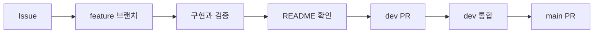

# Ipgo AI

입고ITGO의 FastAPI 서버입니다. 수불부 정제 · 입고 계산 엔진과 AI 인사이트를 담당합니다.
Spring Boot 백엔드가 이 서버를 호출하고, 계산 결과 저장은 백엔드가 합니다.

> 현재는 뼈대 단계입니다. 모든 엔드포인트가 API 명세서 예시를 돌려주는 mock 모드로 동작합니다.

## 실행

Python 3.14가 필요합니다.

```bash
python3.14 -m venv .venv && source .venv/bin/activate
pip install -r requirements-dev.txt
cp .env.example .env
uvicorn app.main:app --reload    # http://localhost:8000/docs 에서 API 확인
pytest -q                        # 테스트
ruff check .                     # 코드 검사
```

## 구조

| 폴더 | 내용 | 담당 |
|---|---|---|
| `app/` | FastAPI 진입점, 라우터, 오류 형식, DB · 파일 읽기 | 공통 |
| `app/routers/engine.py` | `/engine/clean` · `/calculate` · `/scenarios` · `/backtest` | 장준영 |
| `app/routers/insight.py` | `/engine/insight` | 이석형 |
| `engine/` | 계산 엔진 (순수 파이썬, DA-01 ~ DA-13) | 장준영 |
| `insight/` | AI 인사이트 (AI-01 ~ AI-03) | 이석형 |
| `schemas/` | 입출력 계약 (pydantic). Spring DTO의 기준 | 공통 |
| `tests/` | 테스트. `fixtures/`에는 가짜 데이터만 | 공통 |
| `docs/decisions/` | 결정 기록 | 공통 |

자세한 내용은 [구조와 연동](docs/architecture.md)을 봅니다.

## 환경 변수

| 이름 | 설명 | 기본값 |
|---|---|---|
| `ENGINE_MODE` | `mock`이면 명세 예시 응답, `real`이면 실제 계산 | `mock` |
| `DATABASE_URL` | 계산 엔진의 DB 연결 (읽기 전용). 방식 미정 | 없음 |
| `STORAGE_BASE` | 원본 엑셀 저장 위치. 방식 미정 | 없음 |
| `OPENAI_API_KEY` | AI 인사이트 LLM 호출 | 없음 |

## 작업 흐름



## 기본 원칙

- Issue와 PR은 쉬운 한국어로 작성합니다.
- 기술 용어는 억지로 번역하지 않습니다.
- commit은 `type: short English summary` 형식을 사용합니다.
- 모든 PR에서 README 변경 필요 여부를 확인합니다.
- `main`은 작성자 외 팀원 1명의 승인 없이 병합할 수 없습니다.

## 문서

- [개발 문서 안내](docs/README.md)
- [구조와 연동](docs/architecture.md)
- [작업 흐름](docs/rules/workflow.md)
- [작성 규칙](docs/rules/conventions.md)
- [안전 규칙](docs/rules/safety.md)
