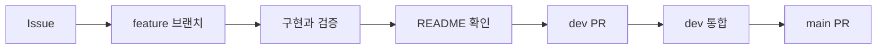

# Ipgo AI

입고ITGO의 FastAPI 서버입니다. 수불부 정제 · 입고 계산 엔진과 AI 인사이트를 담당합니다.
Spring Boot 백엔드가 이 서버를 호출하고, 계산 결과 저장은 백엔드가 합니다.

> 현재는 뼈대 단계입니다. 모든 엔드포인트가 API 명세서 예시를 돌려주는 mock 모드로 동작합니다.

## 실행

Python 3.14가 필요합니다.

```bash
python3.14 -m venv .venv && source .venv/bin/activate
pip install -r requirements-dev.txt
cp .env.example .env
uvicorn app.main:app --reload    # http://localhost:8000/docs 에서 API 확인
pytest -q                        # 테스트
ruff check .                     # 코드 검사
```

## 구조

| 폴더 | 내용 | 담당 |
|---|---|---|
| `app/` | FastAPI 진입점, 라우터, 오류 형식, DB · 파일 읽기 | 공통 |
| `app/routers/engine.py` | `/engine/clean` · `/calculate` · `/scenarios` · `/backtest` | 장준영 |
| `app/routers/insight.py` | `/engine/insight` | 이석형 |
| `engine/` | 계산 엔진 (순수 파이썬, DA-01 ~ DA-13) | 장준영 |
| `insight/` | AI 인사이트 (AI-01 ~ AI-03) | 이석형 |
| `schemas/` | 입출력 계약 (pydantic). Spring DTO의 기준 | 공통 |
| `tests/` | 테스트. `fixtures/`에는 가짜 데이터만 | 공통 |
| `docs/decisions/` | 결정 기록 | 공통 |

자세한 내용은 [구조와 연동](docs/architecture.md)을 봅니다.

## 환경 변수

| 이름 | 설명 | 기본값 |
|---|---|---|
| `ENGINE_MODE` | `mock`이면 명세 예시 응답, `real`이면 실제 계산 | `mock` |
| `DATABASE_URL` | 승인된 view만 조회하는 PostgreSQL read-only 연결 | 없음 |
| `STORAGE_BASE` | 로컬 개발용 원본 엑셀 root. AWS에서는 S3 설정을 우선 사용 | 없음 |
| `AWS_REGION` | S3·SQS를 사용할 AWS Region | `ap-northeast-2` |
| `IPGO_UPLOAD_BUCKET` | AWS 환경에서 원본을 읽을 private S3 bucket | 없음 |
| `IPGO_JOBS_QUEUE_URL` | 정제·계산·백테스트 job queue | 없음 |
| `IPGO_RESULTS_QUEUE_URL` | 처리 결과를 Spring에 전달할 result queue | 없음 |
| `OPENAI_API_KEY` | AI 인사이트 LLM 호출 | 없음 |
| `OPENAI_MODEL` | AI 인사이트 LLM 모델 ([모델 선정](docs/ai-insight/llm-model-selection.md)) | `gpt-4o-mini` |
| `LLM_TIMEOUT_SEC` | LLM 호출 한 번의 시간 제한(초). 넘으면 `LLM_TIMEOUT` | `10` |

AWS에서는 `DATABASE_URL`에 조회 전용 PostgreSQL role만 사용합니다. worker는 SQS를 long polling하고
성공 결과를 result queue에 발행한 뒤 job을 삭제합니다. transient 오류는 job을 삭제하지 않아 SQS의
재시도와 DLQ 정책을 따릅니다.

`dev` 브랜치의 `Deploy AI to AWS dev` workflow는 GitHub OIDC로 image를 ECR에 한 번 push하고
FastAPI service와 worker task definition을 함께 갱신합니다. GitHub `dev` Environment 승인과
`AWS_DEPLOY_ROLE_ARN`, `AWS_ACCOUNT_ID` 변수가 필요합니다. 첫 배포의 기본값은 API 1개,
worker 0개, `ENGINE_MODE=mock`입니다. 실제 계산 엔진과 OpenAI key가 준비된 뒤에만 `real`을
선택하고, 비동기 job 처리가 필요할 때만 worker를 1개 이상 켭니다.

## 작업 흐름



## 기본 원칙

- Issue와 PR은 쉬운 한국어로 작성합니다.
- 기술 용어는 억지로 번역하지 않습니다.
- commit은 `type: short English summary` 형식을 사용합니다.
- 모든 PR에서 README 변경 필요 여부를 확인합니다.
- `main`은 작성자 외 팀원 1명의 승인 없이 병합할 수 없습니다.

## 문서

- [개발 문서 안내](docs/README.md)
- [구조와 연동](docs/architecture.md)
- [작업 흐름](docs/rules/workflow.md)
- [작성 규칙](docs/rules/conventions.md)
- [안전 규칙](docs/rules/safety.md)
- [AI 인사이트 prompt 규칙과 기본 문장](docs/ai-insight/prompt-and-fallback.md)
