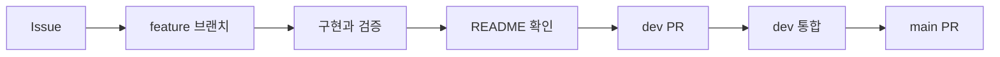

# Ipgo AI

LLM의 OpenAI SDK와 httpx는 배포 의존성에 포함하며 CI에서 실제 runtime 이미지의 앱 import와 client 초기화를 외부 호출 없이 검사합니다.

지속 LLM의 요청 제한과 월 비용 상한 해제 승인 범위는 [지속 LLM 정책](docs/decisions/0011-continuous-insight-limits.md)을 따릅니다. 기본은OFF이며 코드 구현과 실제 활성화는 구분합니다.

입고ITGO의 FastAPI 서버입니다. 수불부 정제 · 입고 계산 엔진과 AI 인사이트를 담당합니다.
Spring Boot 백엔드가 이 서버를 호출하고, 계산 결과 저장은 백엔드가 합니다.

LLM 모델·토큰·nullable 비용 전달과 서버 선반영 순서는 [호출 메타데이터 계약](docs/decisions/0009-insight-usage-metadata.md)을 따릅니다.

기본 HTTP 실행은 mock입니다. `ENGINE_MODE=real`에서는 단일 XLSX 정제와 계산·직접 시나리오에
실제 엔진을 연결합니다. HTTP 계산·직접 입력 시나리오·SQS 계산은 동일 source의 DA08 표본으로
DA-07 위험을 계산하고 인사이트 입력을 조립합니다. 2026년5~7월·주간 기준일·최소20건 정책을 고정했습니다.
전체 백테스트 API/worker는 TUNE 정책 선정과 TEST 평가, DA-13 등급·LOW 경험 출고 범위를 반환합니다.
`/engine/insight`의 LLM은 계산과 별도로 동작하며 사용할 때만 API key가 필요합니다.
real engineVersion은0.6.0입니다. mock 응답은 기존 계약의 정적 예시이며 실제 배포·Spring 저장·LLM 통합은 별도입니다.

## 실행

Python 3.14가 필요합니다.

```bash
python3.14 -m venv .venv && source .venv/bin/activate
pip install -r requirements-dev.txt
cp .env.example .env
uvicorn app.main:app --reload    # http://localhost:8000/docs 에서 API 확인
pytest -q                        # 테스트
ruff check .                     # 코드 검사
```

## 구조

| 폴더 | 내용 | 담당 |
|---|---|---|
| `app/` | FastAPI 진입점, 라우터, 오류 형식, DB · 파일 읽기 | 공통 |
| `app/routers/engine.py` | `/engine/clean` · `/calculate` · `/scenarios` · `/backtest` | 장준영 |
| `app/routers/insight.py` | `/engine/insight` | 이석형 |
| `engine/` | 계산 엔진 (순수 파이썬, DA-01 ~ DA-13) | 장준영 |
| `insight/` | AI 인사이트 (AI-01 ~ AI-03) | 이석형 |
| `schemas/` | 입출력 계약 (pydantic). Spring DTO의 기준 | 공통 |
| `tests/` | 테스트. `fixtures/`에는 가짜 데이터만 | 공통 |
| `docs/decisions/` | 결정 기록 | 공통 |

자세한 내용은 [구조와 연동](docs/architecture.md)을 봅니다.

## 환경 변수

| 이름 | 설명 | 기본값 |
|---|---|---|
| `ENGINE_MODE` | `mock`이면 명세 예시 응답, `real`이면 실제 계산 | `mock` |
| `IPGO_EMBEDDED_WORKER_ENABLED` | API 프로세스 안에서 SQS worker 실행 | `false` |
| `IPGO_ORIGINAL_DATABASE_URL` | DB 원본 전용 ipgo_ai_service_reader 연결. 기존 DATABASE_URL로 대체하지 않음 | 없음 |
| `DATABASE_URL` | 승인된 view만 조회하는 PostgreSQL read-only 연결 | 없음 |
| `STORAGE_BASE` | 로컬 개발용 원본 엑셀 root. AWS에서는 S3 설정을 우선 사용 | 없음 |
| `AWS_REGION` | S3·SQS를 사용할 AWS Region | `ap-northeast-2` |
| `IPGO_UPLOAD_BUCKET` | AWS 환경에서 원본을 읽을 private S3 bucket | 없음 |
| `IPGO_JOBS_QUEUE_URL` | 정제·계산·백테스트 job queue | 없음 |
| `IPGO_RESULTS_QUEUE_URL` | 처리 결과를 Spring에 전달할 result queue | 없음 |
| `IPGO_RISK_ENABLED` | 고정된 DA07 정책으로 표본 생성/위험 계산. false면 미산출 null | `true` |
| `OPENAI_API_KEY` | `real` 모드의 AI 인사이트 LLM 호출에만 필요 | 없음 |
| `OPENAI_MODEL` | AI 인사이트 LLM 모델 ([모델 선정](docs/ai-insight/llm-model-selection.md)) | `gpt-4o-mini` |
| `LLM_TIMEOUT_SEC` | LLM 호출 한 번의 시간 제한(초). 넘으면 `LLM_TIMEOUT` | `10` |

## 계산 함수 연결 (DA-11, #46)

`ENGINE_MODE=real`의 `POST /engine/calculate`와 SQS `CALCULATE` job은 상품별로 다음을 실행합니다.

1. 요청한 `uploadFileIds`와 기준일 이하의 상품 기록을 선택합니다. 요청 `productIds`가 없으면
   조회된 상품과 `settings`의 상품을 모두 대상으로 합니다. 설정·기준일 재고가 없거나 같은 날짜의
   상품 기록이 중복되면 해당 상품을 `NOT_CALCULABLE`과 사유로 반환합니다.
2. 요청 정책의 A/B 예측을 사용하고, 해당 방식이 사용 불가이면 다른 방식으로 대체합니다.
   두 방식 모두 불가이면 권장 수량을 0으로 바꾸지 않고 `NOT_CALCULABLE`로 반환합니다.
3. 예측 분리 → 기존 발주 분리 → 시작 재고 추정 → 신규 입고 0 시뮬레이션으로 도착 전 미충족
   산출 → 필요량 계산 → 입고 단위 올림 순서로 실행합니다.
4. **올림 후 권장 수량**의 80/100/120%를 각각 입고 단위로 올려 시뮬레이션합니다.
   P100은 유지하고 수량이 P100과 같은 P80/P120에 `isDuplicate=true`를 표시합니다.
   권장량이 0이면 `NOT_NEEDED`와 빈 시나리오 목록을 반환합니다.

`POST /engine/scenarios`는 같은 상품 1개의 `calculationInput`으로 예측·시작 재고를 재계산하고,
사용자가 보낸 `qty`를 그대로 적용합니다. 날짜별 결과는 `today+1`부터 `today+H`까지입니다.
잘못된 날짜(`today < asOfDate`), 중복 설정·상품 ID, 여러 상품의 직접 입력 snapshot은 HTTP
422 `INVALID_INPUT`입니다. worker에서 발생한 `CalculationInputError`는 `FAILED/INVALID_INPUT`으로
반환합니다. 일반 DB·네트워크 오류의 기존 재시도 방식은 유지합니다.

이 단계의 `engineVersion`은 `0.6.0`입니다. 입고가 필요한 계산의 `expectedShortageOn`은 신규 입고 0개·기존 발주를 반영한 시뮬레이션에서
커버 기간 안에 재고가 처음 0이 되는 날짜입니다. 기간 밖의 소진일을 임의로 추정하지 않습니다. 단, 기준일 이후 계산일까지 추정 출고로 시작 재고가 이미 0이면 "오늘+1"이 아니라 기준일부터 따라가 마지막으로 바닥난 날(기준일 ~ 오늘)을 줍니다(#72). 예: 기준일 10/31 기말 8개, 하루 5개, 11/6 계산 → 11/2.
HTTP/SQS는 고정 정책의 DA07 context를 공급합니다. 최소20건이면 SKU 또는 POOLED 위험을,
실제 부족이면 INSUFFICIENT_SAMPLE을 반환합니다. 비활성 또는 정책 결정일 전의 요청은 미산출 null입니다.
DA-13 등급은 관측일·TUNE 커버 실적으로 산출합니다. 커버 실적이 없으면 HIGH를 부여하지 않습니다.
LOW 범위는 동일 산식·D의 실적/예측 비율 P10~P90을 H일 예측에 비례 적용하며,
SKU20건→전체SKU20건 순으로 선택합니다. 경험 범위이며 신뢰구간이 아닙니다. 부족하면 null입니다.
**미산출 null은 품절 없음, 위험0%, 평가 통과를 뜻하지 않습니다.** `validObservationDays`는
선택한 상품 기록 중 기준일까지의 유효 관측일 수입니다. 시나리오의 기간 내 소진일·미충족 수요는
기존 DA-06 `simulate()`의 실제 계산 결과입니다.

현재 요청과 DB view에는 검산 제외 사유가 없어 계산 연결에서 `EXCLUDED` 판정을 새로 만들지
않습니다. 정제는 불일치 상품을 validation에 보고하며 checked는 전체 상품 수, target은 그중
고유 제외 상품을 뺀 수입니다. Spring이 정제 결과를 저장한 뒤 계산용 view를 제공합니다.
계산 요청의 모든 업로드 ID는 같은 읽기 전용 DB 연결에서 회원·창고·DONE 상태를 먼저 확인합니다.
DB 미설정은 계산 성공으로 대체하지 않습니다. DB 연결 제한은 5초, 각 SQL 제한은 10초입니다.

### 현재 용량 제한

이 값은 계산 정책이나 정확도 기준이 아니라 현재 서비스의 보호 한도입니다.

- XLSX 원본은 10 MiB, 압축 해제 합계는 16 MiB 이하입니다. 1 MB를 넘는 항목의 압축비가
  1000배를 넘으면 거부합니다. 원본 행은 최대 100,000개, 정제 격자는 재고관리단위×일
  20,000개 및 상품×일 10,000개입니다. XLSX는 단일 파일이며 잘못된 원본은 `INVALID_SOURCE`입니다.
- 상품별 `leadTimeDays + reviewCycleDays`는 최대 366일, `today - asOfDate`는 최대 730일,
  계산 요청의 세 시나리오 예상 결과는 총 10,000일 이내이며 DB 원본 조회는 150,000행 이내입니다. 초과하면 `INVALID_INPUT`입니다.
- DA07 표본 예측 후보는 요청당 최대16,000개입니다. 조정 구간 SKU수×성숙한 기준일수×A/B2개를
  H 및 D별 합산하며 초과하면 INVALID_INPUT입니다. 이 보호 한도와 통계적 최소20건은 다릅니다.
- 한 Python 프로세스에서 정제·계산·시나리오·백테스트는 동시에 하나만 실행합니다. 사용 중인
  HTTP 요청은 503 `ENGINE_BUSY`, worker 메시지는 삭제하지 않고 재시도합니다. 이 잠금은 프로세스
  간 공유되지 않으므로 one-box에서는 API 프로세스 하나와 embedded worker 하나만 사용해야 합니다.
  한도 전체 조합이 256 MiB에서 안전하다고 검증한 것은 아닙니다.

worker는 `ENGINE_MODE`와 관계없이 실제 엔진을 호출합니다. `IPGO_EMBEDDED_WORKER_ENABLED=true`면
API에 worker thread를 띄우고 두 SQS queue URL이 필요합니다. `/health`의 mode는 HTTP 설정을 뜻하며,
embedded worker가 비정상 종료되면 health가 503입니다. worker는 결과 발행 후 메시지를 삭제하므로
발행 또는 삭제 실패 시 중복 결과가 가능하고 Spring은 job ID로 중복을 처리해야 합니다. SQS 수신 오류는
짧게 기다린 후 재시도합니다. 가시성 timeout은 900초이며 자동 갱신하지 않습니다. 결과가 900,000바이트를
넘으면 `RESULT_TOO_LARGE`로 실패합니다.

256 MiB 격리 로컬 컨테이너의 합성 31상품·31일 테스트에서 같은 프로세스의 정제는 0.32초,
계산은 0.25초, cgroup peak는 약 155 MiB였습니다. OOM 및 재시작은 없었습니다. 이는 단일
합성 사례이며 실제 RDS, 네트워크, 동시 부하 및 최대 허용 크기에 대한 검증이 아닙니다.

검증: `pytest -q`, `ruff check .`. 정제 연결 테스트는 가짜 XLSX를 사용하고 계산 연결 테스트는
DB 조회만 대체합니다. 실제 업무 연동 완료나 배포 승인을 뜻하지 않습니다.

## DA-08 최소 시계열 오차 표본 (#36)

`engine.backtest.generate_error_samples()`는 명시한 기준일·평가 길이·TUNE/TEST 구간·관측 확정일로
상품별 A/B를 각각 평가합니다. 예측에는 기준일까지만 쓰고, 실적에는 다음 날부터 평가 종료일까지의
누락 없는 유효 관측 출고량만 씁니다. 미래에 처음 등장한 상품도 관측 확정일 전 표본 대상에 넣지 않습니다.

- 결과는 상품/산식/기준일/평가 종료일별 예측·관측 출고·부호 오차와 `실적/예측` 비율입니다.
  예측이0이거나 비율이 비유한이면 비율은 None이며 사유를 남깁니다. 수량은 올림 전 소수입니다.
- 기록 누락·무효 관측·중복·산식 사용 불가 등은 별도 제외 기록에 남기며, 데이터나 산식을 대체하지 않습니다.
  겹치는 평가 구간은 독립 표본 수로 간주하지 않습니다.
- 이 함수는 내부 표본 생성만 담당합니다. 전체 `run_backtest`/HTTP·worker 응답, MAE/WAPE 집계,
  정책 선정·정확도·DB 저장 연결은 후속입니다. DA07 표본 생성은 HTTP/SQS의 공통 계산 경로에서 호출합니다.
- 상세 입력과 검증 범위는 [DA-08 표본 계약](docs/decisions/0005-da08-error-samples.md)을 따릅니다.

## DA-07 품절 위험 (#36)

`RiskContext`에 DA08 batch·5/1~7/31 조정 기간·최소 표본 수를 명시하고
`calculate(..., risk_context=context)` 또는 `custom_scenario(..., risk_context=context)`에 전달합니다.
HTTP/SQS/직접 입력 경로는 이 context를 자동으로 준비합니다. source 소유권을 확인한 동일 DB 조회 결과를 쓰며
추가 원본을 자동으로 가져오지 않습니다. 기본 정책은 app/risk_policy_2026.json에 최소20건·5/1~7/31·
5/1부터7일 간격 기준일로 고정했고, 사용자 위임으로 결정한2026-11-03 이전 요청에 소급하지 않습니다.

- 실제 사용한 산식과 D=g+H 길이가 같고 기준일까지 실적이 확정된 TUNE 표본만 사용합니다.
  SKU가 충분하면 SKU, 부족하면 대상 SKU를 포함한 전체 SKU를 사용하며 전체도 부족하면 INSUFFICIENT_SAMPLE입니다.
- 각 `실적/예측` 비율을 g일 예측에도 적용해 시작 재고를 다시 구하고, 같은 입고량과 도착일로 H일을 재생합니다.
  위험은 도착 전/후에 미충족 수요가 생긴 사례의 비율이며 기말0만으로 사건을 세지 않습니다.
- 유효 관측일7~13일은 LOW_GRADE로 모든 위험을 보류합니다. DA13 전체 등급/LOW 범위는 만들지 않습니다.
  모순·중복 표본은 오류이며 실제 부족과 구분합니다. 표본 수는 평가 사례 수이고 독립 표본 수가 아닙니다.
- 수량·기본 시나리오의 재고/소진일은 그대로 두고 준비된 위험만 추가합니다. 실제 LLM은 호출하지 않습니다.
  IPGO_RISK_ENABLED=false이거나 request.today가 정책 결정일 이전이면 미산출 null을 유지합니다.
- 최소20건은 경험 빈도 분해능을5%p 이내로 두는 운영 문턱입니다. 주간 조정 표본으로 상품별 사례가
  최대12개(D10)/9개(D34)인 이번 자료는 POOLED가 됩니다. 겹치는 창/상품 간 상관을 독립 표본으로 보지 않습니다.
- 원본은 현재 업로더 격자 제한을 초과합니다. 별도 오프라인에서 조사한 결과를 실제 원장 업로드 성공으로
  확대하지 않습니다. 2025년1월의 입고일 전 비영 기록도 이번에 수정하지 않았습니다.
- 정책 파일은 image에 포함하고 SHA256을 검사합니다. 손상은 HTTP503/RISK_POLICY_INVALID이며 worker는 기존 재시도 경로를 따릅니다.
- 식·출처·제외 규칙·사용 경계는 [DA-07 결정 기록](docs/decisions/0006-da07-stockout-risk.md)을 따릅니다.
  현재 기준/연결·실제 자료 분석 한계는 [0007](docs/decisions/0007-da07-runtime-sampling.md)을 따릅니다.

## AI 인사이트 전송 계약 (#10)

현재 계약은 [0002](docs/decisions/0002-insight-contract.md)입니다. FastAPI는 이름 목록으로 LLM 초안과
검사 결과를 만들고, 숫자·방향 문구 삽입/대조·기본문장·화면 `mode`는 Spring이 처리합니다.

- `InsightInput.placeholders`는 값 dict가 아닌 이름 list입니다. `directions` 값은 `높음/낮음/같음`입니다.
  설명 시나리오와 산식 대체·시작 재고 추정·도착일 없는 발주 여부를 전송할 수 있습니다.
- `InsightResponse`는 기존 초안·통과/실패·사유·시간/비용에 `promptVersion`을 더합니다.
  실제 서비스는 사용한 prompt 버전, 모의 응답은 `mock`을 반환합니다. FastAPI 응답에 `mode`나 기본 문장은 넣지 않습니다.
- 계산 요청의 `noDateReceipts: [{productId, quantity}]`는 설명용이며 해당 상품의 `noDateReceiptQty`로 합산합니다.
  양수 정수 수량만 받고 권장량·재고 시뮬레이션에는 넣지 않습니다. 도착일 있는 발주는 `plannedReceipts`로 분리합니다.
- `engine.insight_facts.to_insight_input(result, sku_label, as_of_date=...)`는 한 상품의 계산 결과를
  이름 목록·비교 방향으로 바꿉니다(#36). 실제 상품명 대신 별칭을 넘기며, 시작 재고 추정 시 요청의 기준일도 필요합니다.
  중복 시나리오를 제외하고 CUSTOM도 처리합니다. 방향은 비교표 표시 기준(재고 내림·위험 정수 %)으로 정합니다.
  `build_catalog`는 값이 있는 키 이름만 만들고 문구 키·실제 수치·상품 ID는 넣지 않습니다.
- 계산 응답은 시나리오 조립 후 변환기를 호출합니다. OK가 아니거나 위험 상태·필수 사실이 없으면 `insightInput`은 null입니다.
  HTTP/SQS real 경로는 DA-07 표본을 생성해 실제 위험 상태를 채운 뒤 변환합니다.
  비활성/정책 결정일 이전·계산 불가·LOW 범위 미완성 등 필수 사실이 없으면 입력을 보류합니다.
  null을 표본 부족이나 SKU 위험으로 추측하지 않습니다. LOW_GRADE의 범위나 OK 위험/표본/기준이 빠져도 생성을 보류합니다.
- mock calculate의 `insightInput`을 그대로 mock insight로 보낼 수 있습니다. 이는 전송 형식 검증용 합성 예시이며
  Spring 저장·유료 LLM 응답의 증거가 아닙니다. 변환 테스트는 기존 합성 결과를 재사용하고,
  HTTP 연결 검증은 가짜 상류 위험 상태와 FakeClient를 씁니다. 실제 위험 산출·유료 LLM·업무 전체 흐름 검증과 구분합니다.

## AWS 데이터 접근 계약

서버 #76의 DB 원본은 [DB 원본 조회 계약](docs/decisions/0005-database-original.md)을 따릅니다.
`db/` storageKey는 V15의 추가 view에서 소유자·창고·크기·SHA-256을 검증해 읽고, 기존 key는 local/S3를 유지합니다.
DB 원본에는 `IPGO_ORIGINAL_DATABASE_URL`의 서비스 전용 조회 계정이 필요합니다. 실제 role을 검사하며 기존 `DATABASE_URL`로 대체하지 않습니다.
DB 원본 자체에는 S3가 필요 없지만 기존 S3 key를 계속 처리하려면 기존 S3 설정을 함께 유지합니다.
서버의 총256MiB·최소30일보존·신규만DB저장 정책을 따르며 공유/개인 계정에는 원본 권한을 추가하지 않습니다.
실제 DB migration·배포·기존 파일 이전은 별도 작업입니다.

Spring이 업무 데이터·상태·결과 저장을 소유하고 FastAPI reader는 다음 view를 `SELECT`만 합니다.
정확한 컬럼·source 선택·권한과 검증 근거는 [조회 전용 view 계약](docs/decisions/0004-reader-view-contract.md)을 따릅니다.

| view | 용도 |
|---|---|
| `ai_product_daily_stocks_v1` | 지정한 DONE source의 상품 일별 계산 입력 |
| `ai_cleaning_sources_v1` | 현재 정제 파일의 소유권·상태와 이전 월 최신 revision 확인 |
| `ai_cleaning_products_v1` | 회원별 기존 바코드와 새 상품 판정 |
| `ai_cleaning_previous_units_v1` | 검증된 이전 파일의 재고관리단위별 월말 기말 |

view는 회원별 RLS를 대신하지 않습니다. repository가 회원·창고·source를 확인하며 reader에는
업무 table 직접 조회·DML·DDL·migration 권한을 주지 않습니다.

단일 호스트 개발 환경에서 `AWS_DEV_COMPUTE_MODE=onebox`는 ARM 이미지와
`ipgo-dev-onebox-ai-api` 서비스를 선택합니다. 검증한 구성은 mock API 최대 1개와 worker 0개이며,
real 모드와 worker는 해당 코드의 메모리·부하를 별도로 검증해야 합니다. 기존 조회 전용 DB·IAM 역할은 유지합니다.
이후 배포에는 AI 서비스의 짧은 재시작이 필요하므로 검토 후 workflow의 `maintenance_approved`를 선택합니다.
서버 이전은 현재 배포 코드로 진행하며 최신 dev·실계산 기능을 자동으로 배포하지 않습니다.
[인프라 운영 문서](https://github.com/IpgoITGO/ipgo-infra/blob/dev/docs/onebox.md)에서 비용·알림·복구 절차를 확인할 수 있습니다.

- Spring Boot가 업무 DB와 상태 변경을 소유합니다. FastAPI는 승인된 계산용 view와 필요한 table을
  `SELECT`만 하며 migration과 데이터 변경을 하지 않습니다.
- 업로드 원본은 private S3 bucket에서 읽습니다. Spring은 읽기·쓰기, FastAPI는 읽기 권한만
  가집니다.
- 정제·계산·백테스트는 SQS worker가 처리하고 결과 queue에 발행합니다. Spring이 결과를 검증해
  DB에 저장합니다.
- 시나리오와 AI 인사이트만 private network의 내부 HTTP로 호출합니다.

현재 기본 실행 모드는 `mock`입니다. S3 읽기, RDS read-only 조회, SQS worker와 AWS dev 배포 경로는
구현되어 있으며 실제 계산 엔진과 Spring 연동이 검증된 기능부터 `real` 모드와 worker를 활성화합니다.

AWS에서는 `DATABASE_URL`에 조회 전용 PostgreSQL role만 사용합니다. worker는 SQS를 long polling하고
성공 결과를 result queue에 발행한 뒤 job을 삭제합니다. transient 오류는 job을 삭제하지 않아 SQS의
재시도와 DLQ 정책을 따릅니다.

`dev` 브랜치의 `Deploy AI to AWS dev` workflow는 GitHub OIDC로 image를 ECR에 한 번 push하고
FastAPI service와 worker task definition을 함께 갱신합니다. GitHub `dev` Environment 승인과
`AWS_DEPLOY_ROLE_ARN`, `AWS_ACCOUNT_ID` 변수가 필요합니다. 첫 배포의 기본값은 API 1개,
worker 0개, `ENGINE_MODE=mock`입니다. `mock` 배포에서는 API task definition에서
`OPENAI_API_KEY` secret 주입을 제외합니다. LLM을 별도로 활성화할 때만 Secrets Manager ARN을 담은
GitHub 변수 `AWS_AI_OPENAI_SECRET_ARN`이 필요합니다. real 계산에 LLM key는 필요하지 않습니다.

자세한 경계와 전환 조건은 [구조와 연동](docs/architecture.md)과
[계산 엔진 연동 계약](docs/decisions/0001-engine-contract.md)을 봅니다.

## 작업 흐름



## 기본 원칙

- Issue와 PR은 쉬운 한국어로 작성합니다.
- 기술 용어는 억지로 번역하지 않습니다.
- commit은 `type: short English summary` 형식을 사용합니다.
- 모든 PR에서 README 변경 필요 여부를 확인합니다.
- `main`은 작성자 외 팀원 1명의 승인 없이 병합할 수 없습니다.

## 문서

- [개발 문서 안내](docs/README.md)
- [구조와 연동](docs/architecture.md)
- [작업 흐름](docs/rules/workflow.md)
- [작성 규칙](docs/rules/conventions.md)
- [안전 규칙](docs/rules/safety.md)
- [AI 인사이트 prompt 규칙과 기본 문장](docs/ai-insight/prompt-and-fallback.md)


## 백테스트와 실제 원장 검증

`POST /engine/backtest`와 SQS `BACKTEST`는 `settings`에 상품별 리드타임·주기·입고단위를
명시해야 합니다(real에서 빈 설정은 INVALID_INPUT). TUNE은5/1~7/31, TEST는8/1~10/14이고
TEST 기준일은9월 말까지만 생성합니다. 주7일 기준이며 예측에는 각 기준일까지의 기록만 씁니다.
A/B 공통 사례의 TUNE WAPE로 기본 산식을 정하고, 커버95%를 달성하는 최소 배수를 선택합니다.
전부 미달이면 최고 성공률(동률 최소 배수)을 선택하고 `targetMet=false`를 반환합니다.
실적0분모·표본0건의 오차/비율/선택 배수는 null로 남깁니다.

`testPolicyMetric`은 고정 정책의 TEST 결과입니다. `excessTargetMet`(TUNE 과잉10% 목표)은
커버 목표와 별개입니다. DA10은 P80/P100/P120의 서로 다른 수량만 집계하고, 위험 구간20사례
미만 비율은 null입니다. DA12는 실제 관측 출고·조정을 같은 조건에 적용한 재생입니다.
과거 예정 발주 정보가 없어 계산 경로에 미래 실제 입고를 제공하지 않습니다. 겹치는 창의
노출 일수/사례를 독립 관측이나 실제 업무 효과로 해석하지 않습니다.
Spring의 BACKTEST job 생성·저장은 아직 별도이며 이 단계는 AI HTTP/worker 응답까지입니다.

입고일 이전 기록은 추정 정정하지 않습니다. 원본을 보존하고 해당 파일의 SKU를 제외하며,
상품 일별 관측을 전부 false로 표시합니다. 입고일 이후의 원본 단위 기록은 다음 월 연결에
보존합니다. 이 제외 파일을 선택하는 동안 Spring의 기존 제외 규칙이 적용됩니다.

큰 SQS 결과는 wire900,000bytes 이하의 gzip/base64 v2로 전송합니다. 해제16MiB 상한을 두며
**서버 decoder를 먼저 배포**해야 합니다. 이번 변경의 검증 범위·원장 출처·복구 순서는
[결정 기록](docs/decisions/0008-ledger-evaluation.md)을 따릅니다. 실제 LLM은 사용하지 않았습니다.

로컬 검증은 AI526개 테스트·Ruff 통과, 첨부22개월 정제/압축과117,640행의 조건부 평가입니다.
256MiB/x86 단독 HTTP31상품 검증은58.3초였습니다. 실제 PostgreSQL·SQS 배달·Spring 저장·ARM·
실사용 효과는 별도 검증이 필요하며, 이 한 번의 관측을 전체60초 SLA 보장으로 해석하지 않습니다.


## 인사이트 오프라인 평가

`insight.evaluation`의 사례 입력·기본 문장·값 치환은 같은 계산 결과 메타데이터를 사용합니다.
`ProductResult`의 값이 있으면 우선하고, 이전 형식의 최상위 필드로 누락값을 보완합니다.
도착 예정일 없는 발주 수량은 기존 호환 규칙대로 결과 수량이 0이면 최상위 값을 사용합니다.

판사 평가 대상은 같은 사례·반복 실행의 최신 호출 기록에서 선택합니다. 최신 결과가 기본 문장,
생성 보류, 빈 문장 또는 대상과 다른 버전이면 과거 성공 문장으로 돌아가지 않습니다.
실험 화면 대상은 `prepared.items`에 표시된 AI 문장과도 일치해야 합니다. `items`가 없는
이전 평가 자료는 최신 기록·버전 규칙으로 처리합니다. 호출 로그와 과거 실패는 보존합니다.

관련 회귀 검사는 `pytest -q tests/test_insight_evaluation.py tests/test_judge.py`로 실행합니다.
가짜 응답을 이용한 오프라인 검사이며 실제 LLM 품질·사용자 업무 효과를 검증한 결과는 아닙니다.

## 개발 배포의 동일 SHA 이미지 재사용

`deploy-dev.yml`은 AWS 인증/기존 승인 검사 이후, 배포 역할의 기존 `ecr:BatchGetImage` 권한으로
현재 workflow SHA 태그를 먼저 조회합니다. onebox는 `<SHA>-arm64`, legacy는 `<SHA>`이며
계정·서울 리전·저장소·태그가 모두 일치해야 합니다. 다른 SHA/아키텍처/서비스 이미지를 대신 쓰지 않습니다.

- 이미지가 있으면 Docker Buildx 설정과 build/push를 모두 건너뛰고 기존 immutable 이미지를 재사용합니다.
- `ImageNotFound`가 요청한 정확한 태그에 대해 반환된 경우에만 기존 build/push를 한 번 수행합니다.
- 권한·통신·저장소 오류, 빈/불완전/모호한 응답은 중단하며 이미지 없음으로 처리하지 않습니다.
- 빌드 또는 재사용 뒤, task를 읽거나 갱신하기 전에 이미지를 다시 확인합니다. 재사용 중 digest가 바뀌거나
  이미지가 사라졌으면 중단합니다. 동시 외부 push로 build가 충돌해도 태그를 삭제하거나 덮어쓰지 않습니다.

이미지 존재와 별개로 기존 환경 승인·서비스 재시작·real/LLM 비용 승인은 계속 필요합니다.
태그 가변 전환·이미지 삭제·새 IAM 권한·실제 배포·LLM 호출은 이 변경에 포함하지 않습니다.
배포에는 기존과 같은 immutable SHA 태그 URI를 전달하고 확인한 digest는 GitHub step output으로 보존합니다.
이 workflow 보완을 병합해도 첫 새 SHA는 이미지가 없으므로 빌드하고, 그 SHA의 이후 재배포부터 재사용합니다.

격리 검사: `python3 -m unittest discover -s scripts/testing -p 'test_ecr_image.py' -v`.
가짜 AWS CLI 응답으로 재사용/신규 빌드 판단·권한/통신 오류 차단·digest 변경·workflow 연결을 검사하며
실제 AWS 배포 성공을 의미하지 않습니다. [ECR BatchGetImage 계약](https://docs.aws.amazon.com/AmazonECR/latest/APIReference/API_BatchGetImage.html).

## 입고 주기 제안 (#92)

실제 정제는 파일 안에서 검산을 통과한 SKU별 양수 입고 날짜를 모읍니다.
같은 날 여러 LOT는 한 날짜로 세고, SKU별 서로 다른 입고일이 3개 이상일 때
연속 간격의 중앙값을 계산합니다. 유효 SKU 중앙값들의 중앙값을 0.5 올림해
`estimatedReviewCycleDays`로 반환하며 표본이 부족하면 null입니다.
수요 관측 flag가 false인 첫 입고도 물리 검산이 맞으면 포함합니다.
다른 SKU 입고일을 섞거나 월 경계/누적 기록을 추정하지 않습니다.
기존 보고서를 자동 재처리하지 않으며 사용자가 확정한 입고 조건은 서버가 보존합니다.

## 상품 상세 정확도 이력 (#93)

현재 계산과 같은 산식·배수·설정으로 2026년 5~7월 TUNE 자료를 재생한 이력을 연결합니다.
각 점은 기준일 다음 날부터 리드타임+검토 주기(H일)의 예측/관측 출고 합계입니다.
당시 발행한 예측의 실측 성과나 독립 TEST 성과가 아닙니다. 겹친 평가 창은 독립 표본으로 해석하지 않습니다.
`covered`는 입고 재생에서 매일 기말 재고가 양수였는지를 뜻합니다.

AI의 CALCULATE `accuracyEvaluation`은 선택적 확장 필드입니다. 원본 소수와 정책·입력 digest를
서버의 기존 `selection_snapshot.resultFacts`에 저장하며, K1에는 정수 올림한 `accuracy.history`와
출처/기간/H/평가 상태를 담은 선택적 `accuracy.evaluation`을 제공합니다. 오차는 원본으로 계산합니다.
기록 없는 구버전은 빈 이력, 표본 없음은 EMPTY, 평가 미실행은 UNAVAILABLE로 구분합니다.
digest에는 NaN·무한대를 문자열 표식으로, 결측·숫자 변환 불가 수량을 `invalid`로 기록합니다.
이 메타데이터 처리로 전체 계산을 실패시키지 않으며, 문제 상품의 계산 불가 사유와 정상 상품의 결과는 유지합니다.
새 BACKTEST 작업·DB migration·LLM 호출·과거 결과 덮어쓰기는 없습니다.

필드·digest 정규화·호환 규칙: [#93 계약](docs/decisions/accuracy-history-93.md).

### 시연용 LLM 자동 만료

개발 배포의 `expected_sha`를 고정하고 `llm_enabled=true`일 때 `llm_expires_at`에 24시간 이내의
UTC 종료 시각을 지정합니다. SDK 요청 직전 만료를 검사하여 종료 이후 호출은 전송하지 않습니다.
진행 중 요청은 응답을 마칠 수 있습니다. 시연 기간에는 gpt-4o-mini snapshot·Standard tier·출력400·n1·
SDK retry0과 입력 JSON UTF-8 바이트+1024 기준16000 상한을 적용합니다. 총 비용 하드캡은 아닙니다.

`source_sha`를 생략하면 workflow의 dev SHA를 배포합니다. 현재 실행 버전에 필요한 변경만 포함한
commit을 배포하려면 dev에 병합된 정확한 source SHA와 같은 `expected_sha`를 지정합니다.
checkout 후 실제 HEAD와 승인 SHA 일치 및 dev의 ancestor 여부를 AWS 쓰기 전에 검사합니다.
workflow head SHA와 실제 source SHA는 배포 기록에서 구분합니다.

## Docker 캐시와 배포 시간 요약

CI와 개발 배포는 BuildKit의 GitHub Actions 캐시를 사용합니다. 캐시 scope는
`ai-${{ runner.arch }}`로 분리하여 x86과 ARM 레이어가 서로 덮어쓰지 않게 합니다.
PR에서는 캐시를 읽기만 하고, dev push CI와 승인된 수동 배포에서만 저장합니다.
캐시 읽기/저장 작업에는 각각 60초 제한을 두며, 캐시 저장 오류는 빌드 성공을 뒤집지 않습니다.
 캐시가 없으면 기존처럼 새로 빌드합니다.
`mode=max`로 중간 빌드 레이어도 보존하므로 저장공간 사용량은 늘 수 있습니다.
같은 SHA의 검증된 ECR 이미지가 있으면 기존 조건대로 빌드를 생략합니다.
캐시가 이미지의 출처·SHA·digest 검증이나 배포 승인을 대신하지 않습니다.

AI는 기존 requirements 설치 레이어를 재사용하며 runtime import·ARM 용량 검사를 유지합니다.

배포 job 마지막의 **Summarize deployment timing**이 Actions 실행의 **Summary**에
시도 시작→job 시작의 대기 합계와 각 단계 시간·결과를 기록합니다. 실행 전 대기는
환경 승인·concurrency·러너 할당을 개별 분리하지 않습니다. 재실행은 현재 시도의
`run_started_at`부터 계산하며 이전 시도의 시간을 더하지 않습니다. job 실행 시간은
요약 생성 시점까지이고 후속 post 처리나 전체 실행 종료까지의 시간이 아닙니다.
ECS 배포 단계는 등록·교체·안정화 대기 합계입니다.

요약은 GitHub의 `actions: read` 권한만 추가로 사용하며 AWS를 호출하지 않습니다.
배포 실패·단계 생략·API 집계 중/조회 실패를 구분하고, 조회 실패가 배포 결과를 바꾸지
않습니다. checkout 이전 실패나 요약 script가 없는 과거 source SHA 배포에서는
요약을 만들 수 없으므로 Actions 기본 job 기록을 확인합니다. 취소 시 러너가 종료되면
요약 실행 자체가 보장되지 않습니다. token이나 API 예외 원문은 출력하지 않습니다.

로컬 검증: `python3 -m unittest discover -s scripts/testing -p 'test_*.py' -v`.
실제 GHA 캐시 저장/복원·native ARM CI·시간 단축 효과는 다음 승인된 실행에서 확인해야 합니다.

## 개발 배포 전후 검증

배포는 기존 수동 승인/정확 SHA 조건을 유지합니다. AWS 인증 전 승인 source SHA의
`test.yml` **dev push** 실행에서 필수 job이 모두 성공했는지 확인합니다. 최신 실행이
실패·취소·진행 중이거나 필수 job이 생략/누락되면 과거 성공으로 대체하지 않고 중단합니다.
검증 도구와 ECR 조회 도구는 dispatch된 workflow SHA에서 임시 디렉터리로 추출하며,
앱 코드는 승인 source SHA 그대로 유지합니다. ECR 이미지 tag도 승인 source SHA로 계산합니다.
동일 SHA의 ECR 재사용·digest 검사와 캐시/시간 요약은 유지합니다.

AI는 deploy-contract/test/arm-capacity/container 성공을 요구하며 계산/인사이트 계약은 변경하지 않습니다.

AWS 인증 후 ECR push/ECS 변경 전에 계정·서울 리전 대상 서비스·실행 task 조회를 확인합니다.
배포 역할에는 기존 권한 외에 개발 cluster로 제한한 `ecs:ListTasks`·`ecs:DescribeTasks`가
필요합니다. Infra bootstrap의 두 배포 역할에 읽기 권한 추가안을 준비했으나 실제 적용은
별도 승인 작업입니다. 실행 task가 없는 경우 DescribeTasks 권한은 이 사전 단계에서
확인할 수 없으며 이후 검증에서 실패할 수 있습니다.

배포 후 deploy action이 반환한 후보 task definition ARN과 실제 서비스/모든 task의
revision·승인 이미지·digest·replica 수·rollout 완료를 대조합니다. OCI index와 실행 플랫폼
manifest digest를 구분하고 다른 플랫폼/attestation digest를 성공으로 처리하지 않습니다.
API 컨테이너의 기존 HTTP healthCheck와 실제 HEALTHY를 확인합니다. 이전 revision으로
되돌아간 안정 상태도 성공으로 처리하지 않으며, 새 자동 재배포/롤백을 실행하지 않습니다.

별도 공개 URL이 없는 AI는 기존 컨테이너 `/health` HTTP probe의 HEALTHY를
검증합니다. 선택적으로 `AWS_DEV_SMOKE_URL`을 설정하면 HTTPS200/JSON status=ok도
확인합니다. 공개 경로·Ingress를 새로 만들거나 내부 URL을 공개하지 않습니다.

0개로 내리는 요청은 정지 상태를 확인하고 실제 앱/HTTP 성공으로 표시하지 않습니다.
AI의 legacy worker는 API와 별도 revision/digest를 검사하며, worker에 healthCheck가
없으면 앱 HEALTHY를 검증했다고 표시하지 않습니다. one-box 별도 worker는 0개를 유지해야 합니다.
외부 HTTP의 200/JSON은 경로 응답 검증이며 그 응답 자체가 image digest를 증명하지는 않습니다.
TLS 검증·redirect 금지를 유지하고 API/CLI 오류 원문이나 token을 로그에 출력하지 않습니다.

검증: `python3 -m unittest discover -s scripts/testing -p 'test_*.py' -v`.
모의 CI/AWS/HTTP 응답으로 실패·rollback·누락·scale-down을 검사하며 실제 배포 검증과 구분합니다.
