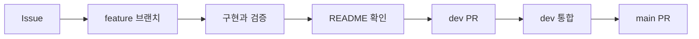

# Ipgo AI

입고ITGO의 FastAPI 서버입니다. 수불부 정제 · 입고 계산 엔진과 AI 인사이트를 담당합니다.
Spring Boot 백엔드가 이 서버를 호출하고, 계산 결과 저장은 백엔드가 합니다.

> 기본 실행은 API 명세서 예시를 돌려주는 mock 모드입니다. `ENGINE_MODE=real`이면 입고 수량 계산과
> 직접 입력 시나리오는 기존 계산 함수를 사용하고, `/engine/insight`는 실제 LLM으로 자리 표시자
> 문장 초안을 만들고 검사합니다(`OPENAI_API_KEY` 필요). 정제 응답 조립·위험·정확도·계산 결과의
> 인사이트 입력 변환과 Spring 저장 연동은 아직 미완료입니다.

## 실행

Python 3.14가 필요합니다.

```bash
python3.14 -m venv .venv && source .venv/bin/activate
pip install -r requirements-dev.txt
cp .env.example .env
uvicorn app.main:app --reload    # http://localhost:8000/docs 에서 API 확인
pytest -q                        # 테스트
ruff check .                     # 코드 검사
```

## 구조

| 폴더 | 내용 | 담당 |
|---|---|---|
| `app/` | FastAPI 진입점, 라우터, 오류 형식, DB · 파일 읽기 | 공통 |
| `app/routers/engine.py` | `/engine/clean` · `/calculate` · `/scenarios` · `/backtest` | 장준영 |
| `app/routers/insight.py` | `/engine/insight` | 이석형 |
| `engine/` | 계산 엔진 (순수 파이썬, DA-01 ~ DA-13) | 장준영 |
| `insight/` | AI 인사이트 (AI-01 ~ AI-03) | 이석형 |
| `schemas/` | 입출력 계약 (pydantic). Spring DTO의 기준 | 공통 |
| `tests/` | 테스트. `fixtures/`에는 가짜 데이터만 | 공통 |
| `docs/decisions/` | 결정 기록 | 공통 |

자세한 내용은 [구조와 연동](docs/architecture.md)을 봅니다.

## 환경 변수

| 이름 | 설명 | 기본값 |
|---|---|---|
| `ENGINE_MODE` | `mock`이면 명세 예시 응답, `real`이면 실제 계산 | `mock` |
| `DATABASE_URL` | 승인된 view만 조회하는 PostgreSQL read-only 연결 | 없음 |
| `STORAGE_BASE` | 로컬 개발용 원본 엑셀 root. AWS에서는 S3 설정을 우선 사용 | 없음 |
| `AWS_REGION` | S3·SQS를 사용할 AWS Region | `ap-northeast-2` |
| `IPGO_UPLOAD_BUCKET` | AWS 환경에서 원본을 읽을 private S3 bucket | 없음 |
| `IPGO_JOBS_QUEUE_URL` | 정제·계산·백테스트 job queue | 없음 |
| `IPGO_RESULTS_QUEUE_URL` | 처리 결과를 Spring에 전달할 result queue | 없음 |
| `OPENAI_API_KEY` | `real` 모드의 AI 인사이트 LLM 호출에만 필요 | 없음 |
| `OPENAI_MODEL` | AI 인사이트 LLM 모델 ([모델 선정](docs/ai-insight/llm-model-selection.md)) | `gpt-4o-mini` |
| `LLM_TIMEOUT_SEC` | LLM 호출 한 번의 시간 제한(초). 넘으면 `LLM_TIMEOUT` | `10` |

## 계산 함수 연결 (DA-11, #46)

`ENGINE_MODE=real`의 `POST /engine/calculate`와 SQS `CALCULATE` job은 상품별로 다음을 실행합니다.

1. 요청한 `uploadFileIds`와 기준일 이하의 상품 기록을 선택합니다. 요청 `productIds`가 없으면
   조회된 상품과 `settings`의 상품을 모두 대상으로 합니다. 설정·기준일 재고가 없거나 같은 날짜의
   상품 기록이 중복되면 해당 상품을 `NOT_CALCULABLE`과 사유로 반환합니다.
2. 요청 정책의 A/B 예측을 사용하고, 해당 방식이 사용 불가이면 다른 방식으로 대체합니다.
   두 방식 모두 불가이면 권장 수량을 0으로 바꾸지 않고 `NOT_CALCULABLE`로 반환합니다.
3. 예측 분리 → 기존 발주 분리 → 시작 재고 추정 → 신규 입고 0 시뮬레이션으로 도착 전 미충족
   산출 → 필요량 계산 → 입고 단위 올림 순서로 실행합니다.
4. **올림 후 권장 수량**의 80/100/120%를 각각 입고 단위로 올려 시뮬레이션합니다.
   P100은 유지하고 수량이 P100과 같은 P80/P120에 `isDuplicate=true`를 표시합니다.
   권장량이 0이면 `NOT_NEEDED`와 빈 시나리오 목록을 반환합니다.

`POST /engine/scenarios`는 같은 상품 1개의 `calculationInput`으로 예측·시작 재고를 재계산하고,
사용자가 보낸 `qty`를 그대로 적용합니다. 날짜별 결과는 `today+1`부터 `today+H`까지입니다.
잘못된 날짜(`today < asOfDate`), 중복 설정·상품 ID, 여러 상품의 직접 입력 snapshot은 HTTP
422 `INVALID_INPUT`입니다. worker에서 발생한 `CalculationInputError`는 `FAILED/INVALID_INPUT`으로
반환합니다. 일반 DB·네트워크 오류의 기존 재시도 방식은 유지합니다.

이 단계의 `engineVersion`은 `0.2.0`입니다. DA-05 소진 예상일, DA-07 품절 위험, DA-13 정확도와
백테스트는 아직 계산하지 않습니다. `expectedShortageOn`, `riskStatus`, 위험도·표본 수·정확도 등급·
평가 수치는 `null`이며 **품절 없음, 위험 0%, 평가 통과를 뜻하지 않습니다.** `validObservationDays`는
선택한 상품 기록 중 기준일까지의 유효 관측일 수입니다. 시나리오의 기간 내 소진일·미충족 수요는
기존 DA-06 `simulate()`의 실제 계산 결과입니다.

현재 요청과 DB view에는 검산 제외 사유가 없어 `EXCLUDED` 판정은 이 연결에서 새로 만들지 않습니다.
정제·제외 상품 전달 계약, 월 경계 검산, `clean()` 조립, 실제 DB/SQS·Spring 저장 연동은 별도입니다.
worker는 HTTP의 mock 분기를 사용하지 않으므로 `ENGINE_MODE=mock`이어도 실제 계산 함수를 호출합니다.

검증:

```bash
pytest -q tests/test_calculate.py   # 기존 DA-03/04/06 손계산 표 + 실제 계산 HTTP/dispatch 경로
pytest -q
ruff check .
```

연결 테스트는 DB 조회만 대체하고 계산 함수는 실제로 실행합니다. AWS queue·실제 PostgreSQL·31개
상품의 전체 사용자 흐름을 검증한 것은 아닙니다. 기본 mock 응답과 `clean`·`backtest`의 미구현
경로는 그대로 유지합니다. `/engine/insight`의 real LLM 호출은 구현되어 있지만, 이 계산 결과에서
인사이트 입력을 만드는 변환과 Spring 연결은 별도 작업입니다.

## AWS 데이터 접근 계약

단일 호스트 개발 환경에서 `AWS_DEV_COMPUTE_MODE=onebox`는 ARM 이미지와
`ipgo-dev-onebox-ai-api` 서비스를 선택합니다. 검증한 구성은 mock API 최대 1개와 worker 0개이며,
real 모드와 worker는 해당 코드의 메모리·부하를 별도로 검증해야 합니다. 기존 조회 전용 DB·IAM 역할은 유지합니다.
이후 배포에는 AI 서비스의 짧은 재시작이 필요하므로 검토 후 workflow의 `maintenance_approved`를 선택합니다.
서버 이전은 현재 배포 코드로 진행하며 최신 dev·실계산 기능을 자동으로 배포하지 않습니다.
[인프라 운영 문서](https://github.com/IpgoITGO/ipgo-infra/blob/dev/docs/onebox.md)에서 비용·알림·복구 절차를 확인할 수 있습니다.

- Spring Boot가 업무 DB와 상태 변경을 소유합니다. FastAPI는 승인된 계산용 view와 필요한 table을
  `SELECT`만 하며 migration과 데이터 변경을 하지 않습니다.
- 업로드 원본은 private S3 bucket에서 읽습니다. Spring은 읽기·쓰기, FastAPI는 읽기 권한만
  가집니다.
- 정제·계산·백테스트는 SQS worker가 처리하고 결과 queue에 발행합니다. Spring이 결과를 검증해
  DB에 저장합니다.
- 시나리오와 AI 인사이트만 private network의 내부 HTTP로 호출합니다.

현재 기본 실행 모드는 `mock`입니다. S3 읽기, RDS read-only 조회, SQS worker와 AWS dev 배포 경로는
구현되어 있으며 실제 계산 엔진과 Spring 연동이 검증된 기능부터 `real` 모드와 worker를 활성화합니다.

AWS에서는 `DATABASE_URL`에 조회 전용 PostgreSQL role만 사용합니다. worker는 SQS를 long polling하고
성공 결과를 result queue에 발행한 뒤 job을 삭제합니다. transient 오류는 job을 삭제하지 않아 SQS의
재시도와 DLQ 정책을 따릅니다.

`dev` 브랜치의 `Deploy AI to AWS dev` workflow는 GitHub OIDC로 image를 ECR에 한 번 push하고
FastAPI service와 worker task definition을 함께 갱신합니다. GitHub `dev` Environment 승인과
`AWS_DEPLOY_ROLE_ARN`, `AWS_ACCOUNT_ID` 변수가 필요합니다. 첫 배포의 기본값은 API 1개,
worker 0개, `ENGINE_MODE=mock`입니다. `mock` 배포에서는 API task definition에서
`OPENAI_API_KEY` secret 주입을 제외합니다. `real` 배포에서는 Secrets Manager ARN을 담은
GitHub 변수 `AWS_AI_OPENAI_SECRET_ARN`이 필요합니다. 실제 계산 엔진과 OpenAI key가 준비된
뒤에만 `real`을 선택하고, 비동기 job 처리가 필요할 때만 worker를 1개 이상 켭니다.

자세한 경계와 전환 조건은 [구조와 연동](docs/architecture.md)과
[계산 엔진 연동 계약](docs/decisions/0001-engine-contract.md)을 봅니다.

## 작업 흐름



## 기본 원칙

- Issue와 PR은 쉬운 한국어로 작성합니다.
- 기술 용어는 억지로 번역하지 않습니다.
- commit은 `type: short English summary` 형식을 사용합니다.
- 모든 PR에서 README 변경 필요 여부를 확인합니다.
- `main`은 작성자 외 팀원 1명의 승인 없이 병합할 수 없습니다.

## 문서

- [개발 문서 안내](docs/README.md)
- [구조와 연동](docs/architecture.md)
- [작업 흐름](docs/rules/workflow.md)
- [작성 규칙](docs/rules/conventions.md)
- [안전 규칙](docs/rules/safety.md)
- [AI 인사이트 prompt 규칙과 기본 문장](docs/ai-insight/prompt-and-fallback.md)
