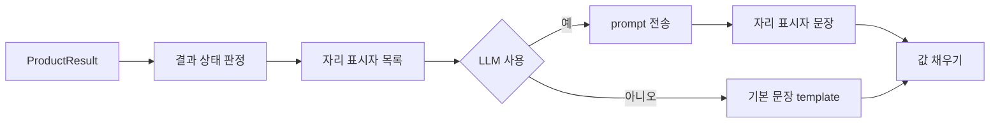

# AI 인사이트 prompt 규칙과 기본 문장 template

- 관련 Issue: #4
- 관련 요구사항: AI-01, AI-02, AI-05, AI-06, DA-11
- 입력 기준: 계산 엔진 계약 `schemas/engine.py`의 `ProductResult` (PR #6)
- 버전: prompt `prompt-2026.10.21-v0.4`, template 초안 (참조 구현 `tpl-2026.10.19-r2`에서 6장 내용으로 변경)

계산 엔진(DA-11)이 만든 결과를 셀러가 빠르게 이해하도록 2~3문장으로 설명하는 규칙입니다. LLM은 숫자를 직접 쓰지 않고 자리 표시자만 씁니다. 실제 값은 나중에 채우고 대조합니다. LLM이 실패하거나 LLM을 쓰지 않는 경우에는 같은 자리 표시자를 쓰는 기본 문장을 보여 줍니다.

## 1. 결과 상태

> 아래 판정 조건은 **제안**입니다. 계산 엔진 계약의 `status`와 `riskStatus`를 조합해 네 가지 상태로 나눕니다. 계산 엔진 담당과 확정해야 합니다.

| 상태 | 판정 조건 | LLM 호출 | 설명하는 내용 |
|---|---|---|---|
| 정상 | `status = OK`, `riskStatus = OK`, 시작 재고 추정 아님 | 예 | 권장량, 시나리오 비교, 품절 위험 |
| 확인 필요 | `status = OK`이고 다음 중 하나: `riskStatus = LOW_GRADE`(예측 정확도 낮음), `startStockEstimated = true`(현재 재고가 추정값) | 예 | 정상 내용 + 셀러가 확인할 사항. 정확도가 낮으면 위험 대신 예상 출고량 범위 |
| 판단 보류 | `status = OK`, `riskStatus = INSUFFICIENT_SAMPLE` | 예 | 권장량과 잔여 재고만. 위험은 "표본이 부족해 산출하지 않았습니다" |
| 산출 불가 | `status`가 `NOT_CALCULABLE`, `EXCLUDED`, `REUPLOAD_REQUIRED` 중 하나 | 아니오 | 계약상 필수인 `reason`을 그대로 보여 줌 |

- 상태는 `산출 불가 > 판단 보류 > 확인 필요 > 정상` 순서로 하나만 고릅니다.
- 시작 재고 추정 문장은 상태와 별도로, 해당하면 항상 덧붙입니다. 예를 들어 판단 보류이면서 시작 재고가 추정값일 수 있습니다.
- `status = NOT_NEEDED`(권장량 0개)는 정상의 한 경우로 봅니다. 계약상 시나리오가 비어 있어 비교할 내용이 없으므로 LLM을 부르지 않고 "입고 불필요" 기본 문장만 보여 줍니다.

## 2. LLM 입력 항목

해당 상품 한 건의 `ProductResult`에서 아래 항목만 골라 보냅니다. 계약이 정의되지 않은 필드를 거부하므로(`extra = "forbid"`) 원본 수불부나 다른 상품 정보는 구조상 들어올 수 없습니다.

| 구분 | 항목 |
|---|---|
| 보냄 | `status`, `riskStatus`, `method`·`methodReason`, `startStockEstimated`, 설명할 시나리오 목록(`isDuplicate = false`), 자리 표시자 목록 |
| 설정으로 선택 | 자리 표시자 실제 값 (`AI_INSIGHT_INCLUDE_VALUES`: 1 = 값 포함, 0 = 키와 방향만) |
| 보내지 않음 | `recommendedAmount`(원가 × 수량), 상품 설정의 `unitCost`(원가), `dailyProjection`, `productId`, 상품명, 수불부 원본, 계정 정보, 다른 상품 |

| 상태 | 추가로 보내는 것 | 빼는 것 |
|---|---|---|
| 정상 | 시나리오별 입고량·소진일·잔여 재고·위험, 권장량 대비 방향, 도착 전 위험 | 중복 시나리오 |
| 확인 필요 | 정상 항목. 정확도가 낮으면 위험 대신 예상 출고량 범위(`forecastRangeLow/High`) | 중복 시나리오. 정확도가 낮으면 위험 자리 표시자 |
| 판단 보류 | 정상 항목에서 위험 값을 빼고 "산출되지 않음"으로 표시 | 위험 자리 표시자, 위험 방향 |
| 산출 불가 | 보내지 않음 (LLM 미호출) | 전부 |

## 3. prompt 규칙

| 구분 | 규칙 |
|---|---|
| 역할 | 계산 엔진이 이미 만든 결과를 셀러에게 설명하는 보조자. 수량을 추천하거나 단정하지 않고, 결정은 셀러가 함 |
| 문장 구성 | ① 권장량과 핵심 결과(두괄식, 위험은 추정치임을 함께) ② 감량·증량 시나리오와의 차이 ③ 도착 전 위험은 모든 시나리오 공통 |
| 문장 수 | 2~3문장, 존댓말 평문 |
| 숫자 | 모든 숫자는 `{{키}}`로만 씀. 수량 뒤 `개`, 일수 뒤 `일`. 위험 값은 `%`가 들어 있으므로 붙이지 않음 |
| 방향 | 비교 결과의 방향은 방향 자리 표시자로만 씀. 문장 중간은 `.connect`, 문장 끝은 `.end` |
| 위험 미산출 | 판단 보류는 "표본이 부족해 산출하지 않았습니다"라고만 씀. 정확도가 낮은 확인 필요 건은 위험을 말하지 않고 `{{range_low}}`~`{{range_high}}` 범위로만 설명 |
| 출력 형식 | JSON 하나: `{"sentences": ["문장1", "문장2"]}`. 줄바꿈·마크다운·따옴표 없음 |

## 4. 금지 규칙

어기면 문장 전체를 버리고 기본 문장을 씁니다. 검사 코드는 별도 Issue에서 구현합니다.

| 금지 | 예 | 검사 사유 코드 |
|---|---|---|
| 자리 표시자 밖의 숫자 | `290개`, `8%`, `80% 시나리오` | `raw_number` |
| 한글 수사 | 두 배, 절반, 열흘, 일주일 | `raw_number` |
| 목록에 없는 자리 표시자 | 중복 시나리오, 위험 미산출 키, 직접 만든 `{{dir.*.s100…}}` | `unknown_key` |
| 필수 자리 표시자 누락 | 정상 상태에서 `{{qty.s100}}` 없음 | `missing_key` |
| 방향을 직접 씀 | 높아집니다, 줄어듭니다, 낮춰요, 올라가요, 증가 | `banned_word` |
| 평가·추천·확정 | 최적, 적절, 안전한, 추천, 반드시, 품절됩니다 | `banned_word` |
| 계산 방식·권장량 변경 제안 | 배수를 낮추세요, 300개로 권장 | `banned_word` |
| 위험을 추정치라고 밝히지 않음 | 위험만 쓰고 `{{risk_basis}}`나 "추정" 없음 | `banned_word` |
| 형식 위반 | JSON 아님, 마크다운, 문장 수 범위 밖 | `format` |

## 5. 자리 표시자 목록

- 형식은 `{{키}}`입니다. 시나리오 키 `K`는 계약의 `type`을 소문자로 바꿔 씁니다: `P80` → `s80`, `P100` → `s100`(권장량), `P120` → `s120`, `CUSTOM` → `custom`.
- 값이 없는 항목은 목록에 넣지 않습니다. 목록에 없는 키를 쓰면 `unknown_key`입니다.
- 정수는 천 단위 쉼표를 넣고 단위 없이 채웁니다. 비율은 `8%`, 날짜는 `6월 15일` 형식입니다.
- 계약에서 소수(`float`)인 값(현재 재고, 예상 출고량, 잔여 재고, 미충족 수요)은 화면 정수 표시 규칙이 확정되면 그 규칙으로 바꿉니다.
- "출처"가 "요청"인 키는 `ProductResult`에 없고 계산 요청(`CalculateRequest`)에 있는 값입니다. 인사이트 요청에 함께 받아야 합니다(7장).

| 키 | 의미 | 출처 | 값 예 | 나오는 조건 |
|---|---|---|---|---|
| `base_date` | 기준일 | 요청 `asOfDate` | 6월 15일 | 시작 재고 추정 시 |
| `cover_days` | 커버 기간(일) = 입고 주기 + 리드타임 | `horizonDays` | 34 | 산출 불가 아님 |
| `current_stock` | 현재 재고(개) | `startStockQty` | 120 | 산출 불가 아님 |
| `pending_qty` | 커버 기간 안에 도착하는 기존 발주 물량(개) | `plannedReceiptsInHorizon` | 50 | 산출 불가 아님 |
| `cannot_reason` | 계산 불가·제외 사유(마침표 없음) | `reason` | 최근 28일 유효 관측일이 … | 산출 불가 |
| `formula` | 적용 산식 이름 | `method` | 계산식 A | 산출 불가 아님 |
| `formula_desc` | 적용 산식 설명 | `method` | 최근 유효 관측일 평균 판매량을 쓰는 방식 | 산출 불가 아님 |
| `formula_reason` | 이 산식을 쓴 이유 | `methodReason` | 작년 자료 없어 B로 대체 | 값이 있을 때 |
| `cover_demand` | 커버 기간 예상 출고량(개, 배수 적용 전) | `forecastOutboundQty` | 410 | 산출 불가 아님 |
| `multiplier` | 여유 배수 | `multiplier` | 110% | 산출 불가 아님 |
| `range_low`, `range_high` | 예상 출고량 범위(개) | `forecastRangeLow/High` | 70, 125 | `riskStatus = LOW_GRADE` |
| `risk_before` | 새 물량 도착 전 품절 위험(공통, 추정치) | `preArrivalRisk` | 5% | 값이 있을 때 |
| `risk_basis` | 위험 기준 | 고정 문구 | 과거 오차 기준 | `riskStatus = OK` |
| `sample_n` | 위험 추정에 쓴 표본 수(건) | `riskSampleSize` | 42 | `riskStatus = OK` |
| `label.K` | 시나리오 명칭 | `type` | 권장량의 80% | 설명 대상 시나리오 |
| `qty.K` | 시나리오 입고량(개) | `qty` | 240 | 설명 대상 시나리오 |
| `deplete.K` | 재고 소진 예상일 | `expectedDepletionOn` | 7월 12일 / 커버 기간 안에 소진되지 않음 | 설명 대상 시나리오 |
| `remain.K` | 다음 입고 시점 잔여 재고(개) | `expectedEndingStock` | 0 | 설명 대상 시나리오 |
| `unmet.K` | 커버 기간 중 미충족 수요(개) | `unmetDemandQty` | 31 | 설명 대상 시나리오 |
| `risk_after.K` | 새 물량 도착 후 품절 위험(추정치) | `postArrivalRisk` | 25% | `riskStatus = OK` |
| `action.K` | 권장량 대비 셀러의 행동 | `qty` 비교 | 줄이면 / 늘리면 / 그대로 두면 | `K ≠ s100` |
| `diff.K` | 권장량과의 입고량 차이(개) | `qty` 비교 | 50 | `K ≠ s100` |
| `dir.remain.K_s100.connect` | 잔여 재고 방향, 문장 중간용 | 잔여 재고 비교 | 줄지만 / 늘지만 / 같고 | `K ≠ s100` |
| `dir.remain.K_s100.end` | 잔여 재고 방향, 문장 끝용 | 잔여 재고 비교 | 줄어듭니다 / 늘어납니다 / 같습니다 | `K ≠ s100` |
| `dir.risk_after.K_s100.connect` | 도착 후 위험 방향, 문장 중간용 | 위험 비교 | 높아지고 / 낮아지고 / 같고 | `K ≠ s100`, `riskStatus = OK` |
| `dir.risk_after.K_s100.end` | 도착 후 위험 방향, 문장 끝용 | 위험 비교 | 높아집니다 / 낮아집니다 / 같습니다 | `K ≠ s100`, `riskStatus = OK` |

- 중복 시나리오(`isDuplicate = true`)는 설명 대상이 아니므로 키를 만들지 않습니다.
- 계약에 권장량 대비 방향 필드가 없으므로, 방향 값은 두 시나리오의 값을 비교해 정합니다.

## 6. 상태별 기본 문장 template

기본 문장은 아래 조각을 상태에 따라 이어 붙인 뒤 자리 표시자를 채웁니다. 조각에 필요한 키가 없으면 문장 없이 비교표만 보여 줍니다(`template_error`). 조각은 표 순서대로 붙입니다.

| 조각 | template | 쓰는 상태 |
|---|---|---|
| 계산 불가 | 이 상품은 권장 입고량을 계산하지 못했습니다. 사유: `{{cannot_reason}}`. | `NOT_CALCULABLE` |
| 계산 제외 | 이 상품은 재고 기록 검산이 맞지 않아 이번 계산에서 제외했습니다. 사유: `{{cannot_reason}}`. | `EXCLUDED` |
| 재업로드 필요 | 이 상품은 수불부를 다시 올려야 계산할 수 있습니다. 사유: `{{cannot_reason}}`. | `REUPLOAD_REQUIRED` |
| 입고 불필요 | `{{formula}}`로 예측한 커버 기간 `{{cover_days}}`일의 예상 출고량은 `{{cover_demand}}`개이고, 현재 재고 `{{current_stock}}`개와 도착 예정 물량 `{{pending_qty}}`개로 충당되어 이번에는 입고가 필요하지 않습니다. | `NOT_NEEDED` |
| 근거 | `{{formula}}`(`{{formula_desc}}`)로 커버 기간 `{{cover_days}}`일 동안 `{{cover_demand}}`개가 팔릴 것으로 예측하고 여유 배수 `{{multiplier}}`를 적용한 뒤, 현재 재고 `{{current_stock}}`개와 도착 예정 물량 `{{pending_qty}}`개를 뺀 권장 입고량은 `{{qty.s100}}`개입니다. | 정상·확인 필요·판단 보류 |
| 산식 사유 | 이 산식을 쓴 이유: `{{formula_reason}}`. | `formula_reason`이 있을 때 |
| 시작 재고 추정 | 현재 재고 `{{current_stock}}`개는 기준일 `{{base_date}}` 이후의 출고를 예측해 추정한 값입니다. | `startStockEstimated = true` |
| 권장량 (위험 있음) | `{{qty.s100}}`개를 넣으면 다음 입고 때 `{{remain.s100}}`개가 남고 도착 후 품절 위험은 `{{risk_basis}}` 추정치로 `{{risk_after.s100}}`입니다(표본 `{{sample_n}}`건). | 정상, 확인 필요(시작 재고 추정만) |
| 권장량 (위험 없음) | `{{qty.s100}}`개를 넣으면 다음 입고 때 `{{remain.s100}}`개가 남습니다. | 판단 보류, 확인 필요(정확도 낮음) |
| 표본 부족 | 품절 위험은 과거 예측 표본이 부족해 산출하지 않았습니다. | 판단 보류 |
| 정확도 낮음 | 과거 예측 오차가 커서 품절 위험 대신 예상 출고량 범위를 보여 드립니다: `{{range_low}}`~`{{range_high}}`개. | 확인 필요(정확도 낮음) |
| 다른 시나리오 (위험 있음) | `{{qty.K}}`개로 `{{action.K}}` 다음 입고 때 남는 재고는 `{{remain.K}}`개로 `{{dir.remain.K_s100.connect}}` 품절 위험은 `{{risk_after.K}}`로 `{{dir.risk_after.K_s100.end}}`. | 정상, 확인 필요(시작 재고 추정만) |
| 다른 시나리오 (위험 없음) | `{{qty.K}}`개로 `{{action.K}}` 다음 입고 때 남는 재고는 `{{remain.K}}`개로 `{{dir.remain.K_s100.end}}`. | 판단 보류, 확인 필요(정확도 낮음) |
| 도착 전 위험 | 새 물량이 도착하기 전까지의 품절 위험은 수량과 관계없이 `{{risk_before}}`입니다. | `risk_before`가 있을 때 |

### 상태별 예시 결과

> 참조 구현(ai_insight v0.2)으로 샘플 계산 결과를 넣어 만든 문장을, 위 template에 맞게 **손으로 고친 예시**입니다. 정확도 낮음 예시의 범위 값(70~125개)은 설명용 가정입니다. 코드를 옮긴 뒤 다시 생성해 대조합니다.

정상 — 중복 시나리오가 있는 건 (P80 = 권장량)

계산식 A(작년 같은 시기 판매량에 올해 최근 흐름을 반영하는 방식)로 커버 기간 34일 동안 40개가 팔릴 것으로 예측하고 여유 배수 105%를 적용한 뒤, 현재 재고 10개와 도착 예정 물량 0개를 뺀 권장 입고량은 50개입니다. 50개를 넣으면 다음 입고 때 20개가 남고 도착 후 품절 위험은 과거 오차 기준 추정치로 6%입니다(표본 40건). 100개로 늘리면 다음 입고 때 남는 재고는 70개로 늘지만 품절 위험은 1%로 낮아집니다. 새 물량이 도착하기 전까지의 품절 위험은 수량과 관계없이 12%입니다.

확인 필요 — 예측 정확도 낮음 (LOW_GRADE)

계산식 B(최근 유효 관측일 평균 판매량을 쓰는 방식)로 커버 기간 34일 동안 96개가 팔릴 것으로 예측하고 여유 배수 110%를 적용한 뒤, 현재 재고 30개와 도착 예정 물량 0개를 뺀 권장 입고량은 84개입니다. 이 산식을 쓴 이유: 작년 자료 없어 B로 대체. 84개를 넣으면 다음 입고 때 18개가 남습니다. 과거 예측 오차가 커서 품절 위험 대신 예상 출고량 범위를 보여 드립니다: 70~125개. 72개로 줄이면 다음 입고 때 남는 재고는 0개로 줄어듭니다. 108개로 늘리면 다음 입고 때 남는 재고는 42개로 늘어납니다.

판단 보류 — 표본 부족 (INSUFFICIENT_SAMPLE)

계산식 B(최근 유효 관측일 평균 판매량을 쓰는 방식)로 커버 기간 34일 동안 96개가 팔릴 것으로 예측하고 여유 배수 110%를 적용한 뒤, 현재 재고 30개와 도착 예정 물량 0개를 뺀 권장 입고량은 84개입니다. 이 산식을 쓴 이유: 작년 자료 없어 B로 대체. 84개를 넣으면 다음 입고 때 18개가 남습니다. 품절 위험은 과거 예측 표본이 부족해 산출하지 않았습니다. 72개로 줄이면 다음 입고 때 남는 재고는 0개로 줄어듭니다. 108개로 늘리면 다음 입고 때 남는 재고는 42개로 늘어납니다.

산출 불가 — NOT_CALCULABLE

이 상품은 권장 입고량을 계산하지 못했습니다. 사유: 최근 28일 유효 관측일이 최소 기준에 미달하고 작년 동일 구간 자료가 없습니다.

입고 불필요 — NOT_NEEDED

계산식 B로 예측한 커버 기간 34일의 예상 출고량은 210개이고, 현재 재고 500개와 도착 예정 물량 100개로 충당되어 이번에는 입고가 필요하지 않습니다.

## 7. 확인이 필요한 사항

| 항목 | 내용 | 확인할 사람 |
|---|---|---|
| 상태 판정 조건 | 1장의 확인 필요 조건(`LOW_GRADE`, `startStockEstimated`), `LOW_GRADE`일 때 `preArrivalRisk`도 비는지, `NOT_NEEDED`에 직접 입력 시나리오를 붙일지, `REUPLOAD_REQUIRED`를 산출 불가에 넣을지 | 계산 엔진 담당 |
| 필드 의미 | `plannedReceiptsInHorizon`을 도착 예정 **수량**으로 보았습니다(건수라면 `pending_qty`에 쓸 수 없음). `forecastRangeLow/High`를 커버 기간 예상 **출고량** 범위로 보았습니다(5장 `range_low/high`, 6장 정확도 낮음 문장) | 계산 엔진 담당 |
| 자리 표시자 형식 | 이 문서는 `{{qty.s100}}`(중괄호 2개)를 씁니다. PR #6 초안(`schemas/insight.py`, mock)은 `{qty_p100}`입니다. 기존 검사기와 맞고 JSON 중괄호와 헷갈리지 않는 이 문서 형식을 제안합니다 | AI·계산 엔진·백엔드 담당 |
| 인사이트 입력 계약 | PR #6 초안 `InsightInput`(키 이름 목록 + 방향)으로는 2장 항목과 6장 문장을 만들 수 없습니다. `ProductResult`(원가 필드 제외)와 요청 값(`asOfDate`)을 받도록 바꾸는 것을 제안합니다 | AI·백엔드 담당 |
| 값 채우기와 기본 문장 위치 | 명세상 값 대조(`VALUE_MISMATCH`)는 Spring이 합니다. 기본 문장 생성도 Spring에서 할지, FastAPI가 기본 문장 초안을 함께 돌려줄지 정해야 합니다 | AI·백엔드 담당 |
| 소수 표시 | 잔여 재고·예상 출고량 등 소수 값의 화면 정수 규칙(올림·내림) | 프론트·백엔드 담당 |
| 명세 예시 문장 | PR #6 mock `insight.json` draft에 "낮춰요", "올라가요" 같은 방향 표현이 들어 있어 4장 금지 규칙과 맞지 않습니다 | AI 담당 |
| 참조 구현과의 차이 | 이 문서의 template은 참조 구현과 다릅니다. 위험 미산출 문장을 한 번만 쓰고, 산출 불가 문장을 상태별로 나누고, 확인 필요 조각을 추가하고, 미반영 물량·직접 입력·전체 상품 표본 문장을 뺐습니다. 4장의 "낮춰요", "올라가요"는 참조 구현 검사 단어 목록에 아직 없습니다. 코드를 옮길 때 반영합니다 | AI 담당 |
| 문장 수 | prompt는 2~3문장, 참조 구현 검사 기준은 2~5문장. 예비 평가 후 하나로 확정 | AI 담당 |
| 상태별 prompt | 지금은 모든 상태에 같은 system prompt를 씁니다. 판단 보류·정확도 낮음 건에는 위험이 없는 예시 문장을 따로 둘지 검토 | AI 담당 |
