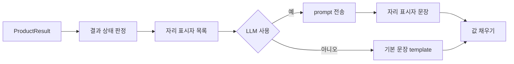

# AI 인사이트 prompt 규칙과 기본 문장 template

- 관련 Issue: #4
- 관련 요구사항: AI-01, AI-02, AI-05, AI-06, DA-11
- 입력 기준: 계산 엔진 계약 `schemas/engine.py`의 `ProductResult` (PR #6), 자리 표시자 이름과 엔진 결정은 [0002](../decisions/0002-insight-contract.md) 3-4 · 3-8
- 버전: 현재 `insight/prompt.py`의 `PROMPT_VERSION = prompt-2026.11.13-v0.7`.
  v0.6(#43, #53)의 system prompt·측정 fixture는 보존하고 user prompt의 상태 설명·괄호 지침을 보완했습니다.
  기존 실제 LLM 측정은 v0.6의 근거이며 v0.7의 효과를 검증한 기록이 아닙니다.
  template 2차는 6장의 Spring 구현용 정리(#14, #24)를 유지합니다.

계산 엔진(DA-11)이 만든 결과를 셀러가 빠르게 이해하도록 2~3문장으로 설명하는 규칙입니다. LLM은 숫자를 직접 쓰지 않고 자리 표시자만 씁니다. 실제 값은 나중에 채우고 대조합니다. LLM이 실패하거나 LLM을 쓰지 않는 경우에는 같은 자리 표시자를 쓰는 기본 문장을 보여 줍니다.

## 1. 결과 상태

> 계산 엔진 계약의 `status`와 `riskStatus`를 조합해 네 가지 상태로 나눕니다. [0002](../decisions/0002-insight-contract.md) 4장이 이 판정을 기준으로 삼았습니다. 0002 4장대로 도착 예정일 없는 발주도 확인 필요에 넣습니다(Spring이 `noDateReceipts`로 보냄, IpgoITGO/ipgo-server#25 답변 4).

| 상태 | 판정 조건 | LLM 호출 | 설명하는 내용 |
|---|---|---|---|
| 정상 | `status = OK`, `riskStatus = OK`, 시작 재고 추정 아님 | 예 | 권장량, 시나리오 비교, 품절 위험 |
| 확인 필요 | `status = OK`이고 다음 중 하나: `riskStatus = LOW_GRADE`(예측 정확도 낮음), `startStockEstimated = true`(현재 재고가 추정값), `noDateReceiptQty > 0`(도착 예정일 없는 발주) | 예 | 정상 내용 + 셀러가 확인할 사항. 정확도가 낮으면 위험 대신 예상 출고량 범위 |
| 판단 보류 | `status = OK`, `riskStatus = INSUFFICIENT_SAMPLE` | 예 | 권장량과 잔여 재고만. 위험은 "표본이 부족해 산출하지 않았습니다" |
| 산출 불가 | `status`가 `NOT_CALCULABLE`, `EXCLUDED`, `REUPLOAD_REQUIRED` 중 하나 | 아니오 | 계약상 필수인 `reason`을 그대로 보여 줌 (Spring 기본 문장, 6장) |

- 상태는 `산출 불가 > 판단 보류 > 확인 필요 > 정상` 순서로 하나만 고릅니다.
- 시작 재고 추정 문장은 상태와 별도로, 해당하면 항상 덧붙입니다. 예를 들어 판단 보류이면서 시작 재고가 추정값일 수 있습니다.
- `status = NOT_NEEDED`(권장량 0개)는 정상의 한 경우로 봅니다. 계약상 시나리오가 비어 있어 비교할 내용이 없으므로 LLM을 부르지 않고 Spring이 "입고 불필요" 기본 문장만 보여 줍니다(IpgoITGO/ipgo-server#25 답변 5). 직접 입력 시나리오가 있어도 LLM을 부르지 않습니다(#32 측정: 권장량 자리 표시자가 없어 "권장 입고량은 0개"처럼 숫자를 직접 씀, 6건 중 0건 통과).

## 2. LLM 입력 항목

해당 상품 한 건의 `ProductResult`에서 아래 항목만 골라 보냅니다. 계약이 정의되지 않은 필드를 거부하므로(`extra = "forbid"`) 원본 수불부나 다른 상품 정보는 구조상 들어올 수 없습니다.

| 구분 | 항목 |
|---|---|
| 보냄 | `status`, `riskStatus`, `method`·`methodReason`, `startStockEstimated`, 설명할 시나리오 목록(`isDuplicate = false`), 자리 표시자 목록 |
| 설정으로 선택 | 자리 표시자 실제 값 (`AI_INSIGHT_INCLUDE_VALUES`: 1 = 값 포함, 0 = 키와 방향만). 값을 넣으면 3장 "값 포함 시" 지시를 반드시 함께 넣음 |
| 보내지 않음 | `recommendedAmount`(원가 × 수량), 상품 설정의 `unitCost`(원가), `dailyProjection`, `productId`, 상품명, 수불부 원본, 계정 정보, 다른 상품 |

| 상태 | 추가로 보내는 것 | 빼는 것 |
|---|---|---|
| 정상 | 시나리오별 입고량·소진일·잔여 재고·위험, 권장량 대비 방향, 도착 전 위험 | 중복 시나리오 |
| 확인 필요 | 정상 항목. 정확도가 낮으면 위험 대신 예상 출고량 범위(`forecastRangeLow/High`) | 중복 시나리오. 정확도가 낮으면 위험 자리 표시자 |
| 판단 보류 | 정상 항목에서 위험 값을 빼고 "산출되지 않음"으로 표시 | 위험 자리 표시자, 위험 방향 |
| 산출 불가 | 보내지 않음 (LLM 미호출) | 전부 |

## 3. prompt 규칙

| 구분 | 규칙 |
|---|---|
| 역할 | 계산 엔진이 이미 만든 결과를 셀러에게 설명하는 보조자. 수량을 추천하거나 단정하지 않고, 결정은 셀러가 함 |
| 문장 구성 | ① 권장량과 핵심 결과(두괄식, 위험은 추정치임을 함께) ② 감량·증량 시나리오와의 차이 ③ 도착 전 위험은 모든 시나리오 공통 |
| 문장 수 | 2~3문장, 존댓말 평문 |
| 숫자 | 모든 숫자는 `{{키}}`로만 씀. 수량 뒤 `개`, 일수 뒤 `일`. 위험 값은 `%`가 들어 있으므로 붙이지 않음 |
| 값 포함 시 | 자리 표시자 목록의 `[값: …]`은 내용을 이해하라고 보여 주는 참고값. 문장에는 값을 옮겨 쓰지 않고 `{{이름}}`을 그대로 씀. 예: `290개`(×) → `{{qty_p100}}개`(○), `계산식 A`(×) → `{{method}}`(○). 금지 규칙 첫 줄에 둠 |
| 방향 | 비교 결과의 방향은 방향 자리 표시자로만 씀. 문장 중간은 `_connect`, 문장 끝은 `_end`. 값(줄지만 · 높아집니다 등)은 Spring이 채움(6-3) |
| 위험 미산출 | 판단 보류는 "표본이 부족해 산출하지 않았습니다"라고만 씀. 정확도가 낮은 확인 필요 건은 위험을 말하지 않고 `{{forecast_range_low}}`~`{{forecast_range_high}}` 범위로만 설명 |
| 작성 예시 | 상태마다 하나씩 둠(아래). 판단 보류 · 정확도 낮음 예시는 6장 "위험 없음" 조각으로 만들고, 위험(`risk_`) · 위험 방향(`dir_risk_post_`) 자리 표시자를 쓰지 않는다고 적음 |
| 셀러가 확인할 사항 | 입력 메타데이터(#58) `startStockEstimated` · `hasNoDateReceipts`가 true이고 해당 키(`start_stock` · `as_of_date`, `no_date_receipts`)가 있으면 사용자 prompt에 "셀러가 확인할 사항(지침 4)" 줄 하나를 넣음. LLM은 그 괄호 글을 마지막 문장 끝 마침표 앞에 붙이고 문장 수는 늘리지 않음. 글은 6장 조각 8 · 7과 같은 뜻: `(현재 재고 {{start_stock}}개는 기준일 {{as_of_date}} 이후 출고를 예측한 추정값, 도착 예정일 없는 발주 {{no_date_receipts}}개는 계산에 넣지 않음)`(해당하는 것만). 1장 "확인 필요" 조건이며 검사기 필수 키는 아님. 기존 요청의 기본값(false)은 근거로 쓰지 않음(0002 4장). 산식 대체(`methodFallback`)는 1장 조건이 아니라 넣지 않고 기존 "적용 산식 … (사유 있음 → {{method_reason}})" 줄을 그대로 씀 (#53) |
| 키가 빠진 입력 | 작성 예시의 키가 목록에 없거나 시나리오 방향 키가 없으면, 사용자 prompt에 "※ 이번 목록에 없는 자리 표시자 … 빼고 씀", "※ 방향 자리 표시자가 없는 비교 … 다른 시나리오의 방향 키로 대신하지 않음"을 덧붙임. 키가 다 있으면 붙이지 않음 (#43) |
| 출력 형식 | JSON 하나: `{"sentences": ["문장1", "문장2"]}`. 배열 원소 하나에 문장 하나. 줄바꿈·마크다운·따옴표 없음 |

### 상태별 작성 예시

prompt에는 입력 상태에 맞는 예시 하나를 따르라고 적고 세 개를 함께 넣습니다. 시험 prompt 고정본(`tests/fixtures/insight_prompts.json`)과 같은 문장입니다.

| 상태 | 예시 |
|---|---|
| 정상 (위험 있음) | `{"sentences": ["{{method}} 기준 권장 입고량은 {{qty_p100}}개이며, 다음 입고 때 {{ending_p100}}개가 남고 도착 후 품절 위험은 {{risk_basis}} 추정치로 {{risk_post_p100}}입니다(표본 {{risk_sample_size}}건).", "{{label_p80}}인 {{qty_p80}}개로 {{action_p80}} 다음 입고 때 남는 재고는 {{ending_p80}}개로 {{dir_ending_p80_connect}} 품절 위험은 {{risk_post_p80}}로 {{dir_risk_post_p80_end}}.", "새 물량이 도착하기 전까지의 품절 위험은 수량과 관계없이 {{risk_pre}}입니다."]}` |
| 판단 보류 | `{"sentences": ["{{method}} 기준 권장 입고량은 {{qty_p100}}개이며, 다음 입고 때 {{ending_p100}}개가 남습니다.", "{{label_p80}}인 {{qty_p80}}개로 {{action_p80}} 다음 입고 때 남는 재고는 {{ending_p80}}개로 {{dir_ending_p80_end}}.", "품절 위험은 과거 예측 표본이 부족해 산출하지 않았습니다."]}` |
| 확인 필요 (정확도 낮음) | `{"sentences": ["{{method}} 기준 권장 입고량은 {{qty_p100}}개이며, 다음 입고 때 {{ending_p100}}개가 남습니다.", "예측 기록이 짧아 품절 위험은 산출하지 않았고, 커버 기간 예상 출고량은 {{forecast_range_low}}~{{forecast_range_high}}개로 봅니다.", "{{label_p80}}인 {{qty_p80}}개로 {{action_p80}} 다음 입고 때 남는 재고는 {{dir_ending_p80_end}}."]}` |

> 근거 (#32, 10/30, gpt-4o-mini · gpt-4o 각 15~18회): 참조 구현 prompt를 0002 이름으로만 옮기면 두 모델 모두 `[값]`을 그대로 옮겨 써 통과율 0%였습니다. "값 포함 시" 지시를 넣자 gpt-4o-mini 55.6%(정상 계열은 모두 통과, 판단 보류 · 확인 필요는 정상 예시를 따라 하다 실패), 상태별 예시를 나누자 100%였습니다. gpt-4o는 같은 prompt에서 46.7%로, 시나리오 명칭에 "80%"를 직접 쓰는 실패가 남았습니다.

## 4. 금지 규칙

어기면 FastAPI가 문장 전체를 버리고 `FAILED`(`VALIDATION_FAILED`)를 돌려주며, Spring이 기본 문장을 씁니다(6-1). 검사 코드는 `insight/validator.py`(#29, #43)입니다.

| 금지 | 예 | 검사 사유 코드 |
|---|---|---|
| 자리 표시자 밖의 숫자 | `290개`, `8%`, `80% 시나리오`, 목록의 `[값]`을 옮겨 쓴 것 | `raw_number` |
| 한글 수사 | 두 배, 절반, 열흘, 일주일 | `raw_number` |
| 목록에 없는 자리 표시자 | 중복 시나리오, 위험 미산출 키, 직접 만든 `{{dir_*_p100_*}}` | `unknown_key` |
| 필수 자리 표시자 누락 | 아래 필수 자리 표시자가 없음. 예: 정상 상태에서 `{{qty_p100}}` 없음 | `missing_key` |
| 시나리오 짝이 맞지 않음 | 80% 문장(`{{qty_p80}}`)에 120%의 `{{dir_ending_p120_connect}}` · `{{risk_post_p120}}`, 주어 시나리오 없이 쓴 방향 키. 값을 넣으면 "줄이면 재고는 늘지만"처럼 반대 문장이 되는데 키 · 값 단위 대조로는 못 잡음 (#43) | `scenario_mismatch` |
| 방향을 직접 씀 | 높아집니다, 줄어듭니다, 낮춰요, 올라가요, 증가 | `banned_word` |
| 평가·추천·확정 | 최적, 적절, 안전한, 추천, 반드시, 품절됩니다 | `banned_word` |
| 계산 방식·권장량 변경 제안 | 배수를 낮추세요, 300개로 권장 | `banned_word` |
| 위험을 추정치라고 밝히지 않음 | 위험만 쓰고 "과거 오차 기준"이나 "추정" 없음 | `banned_word` |
| 형식 위반 | JSON 아님, 마크다운, 문장 수 범위 밖, 문장 안에서 짝이 맞지 않는 괄호 | `format` |

상태 설명은 `산출되지 않음(표본 부족)` 같은 조각 대신 완결된 존댓말로 전달합니다.
셀러 확인 사항은 문장 끝 마침표 앞의 한 괄호로 붙이며, 앞의 상태 설명 괄호에 겹쳐 넣지 않습니다.
검사 실패는 기존 `VALIDATION_FAILED` 응답과 Spring의 기본 문장 대체로 처리하고 재호출하지 않습니다.
진단용 사유(`format`, `truncated`, `missing_key` 등)와 모델·시간·사용량은 WARNING 로그로 남깁니다.
생성 초안·prompt·자리 표시자 값은 로그에 남기지 않습니다. 성공 로그는 기존 INFO를 유지합니다.

필수 자리 표시자는 `riskStatus`로 정합니다(`insight/prompt.py` `required_keys`). 목록에 없는 키는 필수에서 뺍니다.

| `riskStatus` | 필수 자리 표시자 |
|---|---|
| `OK` | `qty_p100` · `risk_post_p100` · `risk_pre` |
| `INSUFFICIENT_SAMPLE` | `qty_p100` |
| `LOW_GRADE` | `qty_p100` · `forecast_range_low` · `forecast_range_high` |

## 5. 자리 표시자 목록

- 형식은 `{{키}}`입니다. 이름은 [0002](../decisions/0002-insight-contract.md) 3-4를 따릅니다. 시나리오 접미사 `X`는 계약의 `type`을 소문자로 바꿔 씁니다: `P80` → `p80`, `P100` → `p100`(권장량), `P120` → `p120`, `CUSTOM` → `custom`. 예: `qty_p100`.
- †는 숫자가 아닌 문구입니다. 값은 Spring이 6-3 표로 채웁니다(#24. 0002 3-6은 FastAPI가 채우는 쪽이었음, 7장). 이름은 다른 키와 같이 점 없는 snake_case로 씁니다(0002 2-2 · 3-4 `dir_ending_pK_connect`). #32 측정에서 참조 prompt는 이름 형식만 바꿔도(`dir.remain.X_p100.connect` → snake_case) 값을 옮겨 쓰기 시작해서, 이름 형식에 기대지 않고 3장 "값 포함 시" 지시로 막습니다.
- 값이 없는 항목은 목록에 넣지 않습니다. 목록에 없는 키를 쓰면 `unknown_key`입니다.
- 값은 Spring이 비교표와 같은 숫자 형식으로 채웁니다(6-4). 아래 "값 예"는 정수에 천 단위 쉼표, 비율 `8%`, 날짜 `6월 15일` 형식입니다. 계약에서 소수(`float`)인 값(현재 재고, 예상 출고량, 잔여 재고, 미충족 수요)도 비교표 규칙을 따릅니다.
- "출처"가 "요청"인 키는 `ProductResult`에 없고 계산 요청(`CalculateRequest`)에 있는 값입니다. 인사이트 요청에 함께 받아야 합니다(7장).

| 키 | 의미 | 출처 | 값 예 | 나오는 조건 |
|---|---|---|---|---|
| `as_of_date` | 기준일 | 요청 `asOfDate` | 6월 15일 | 시작 재고 추정 시 |
| `horizon_days` | 커버 기간(일) = 입고 주기 + 리드타임 | `horizonDays` | 34 | 산출 불가 아님 |
| `start_stock` | 현재 재고(개) | `startStockQty` | 120 | 산출 불가 아님 |
| `planned_receipts` | 커버 기간 안에 도착하는 기존 발주 수량 합계(개) | `plannedReceiptsInHorizon` | 50 | 산출 불가 아님 |
| `no_date_receipts` | 도착 예정일이 없어 계산에 넣지 않은 기존 발주 수량(개) | `noDateReceiptQty` (스키마 반영 전, #10) | 30 | `status = OK`, 0보다 큼 (0002 3-8) |
| `reason` | 계산 불가·제외 사유(마침표 없음) | `reason` | 판매한 날(유효 관측일)이 7일보다 적어요 | 산출 불가 |
| `method` | 적용 산식 이름 | `method` | 계산식 A | 산출 불가 아님 |
| `formula_desc` † | 적용 산식 설명 | `method` | 최근 유효 관측일 평균 판매량을 쓰는 방식 | 산출 불가 아님 |
| `method_reason` | 이 산식을 쓴 이유 | `methodReason` | 작년 자료 없어 B로 대체 | `methodFallback = true` (0002 3-3) |
| `forecast_outbound` | 커버 기간 예상 출고량(개, 배수 적용 전) | `forecastOutboundQty` | 410 | 산출 불가 아님 |
| `multiplier` | 여유 배수 | `multiplier` | 110% | 산출 불가 아님 |
| `forecast_range_low`, `forecast_range_high` | 커버 기간 예상 출고량 범위(개) | `forecastRangeLow/High` | 70, 125 | `riskStatus = LOW_GRADE` |
| `risk_pre` | 새 물량 도착 전 품절 위험(공통, 추정치) | `preArrivalRisk` | 5% | `riskStatus = OK` (0002 3-8) |
| `risk_sample_size` | 위험 추정에 쓴 표본 수(건) | `riskSampleSize` | 42 | `riskStatus = OK` |
| `risk_basis` † | 위험 추정 기준 | `riskBasis` (`SKU` · `POOLED`, 스키마 반영 전 — 0002 합의 후 할 일) | 이 상품의 과거 오차 기준 / 전체 상품의 과거 오차 기준 | `riskStatus = OK` (0002 3-8, 10/28 pooled 사용으로 변경) |
| `label_X` † | 시나리오 명칭 | `type` | 권장량의 80% | 설명 대상 시나리오 |
| `qty_X` | 시나리오 입고량(개) | `qty` | 240 | 설명 대상 시나리오 |
| `depletion_X` | 재고 소진 예상일 | `expectedDepletionOn` | 7월 12일 / 커버 기간 안에 소진되지 않음 | 설명 대상 시나리오 |
| `ending_X` | 다음 입고 시점 잔여 재고(개) | `expectedEndingStock` | 0 | 설명 대상 시나리오 |
| `unmet_X` | 커버 기간 중 미충족 수요(개) | `unmetDemandQty` | 31 | 설명 대상 시나리오 |
| `risk_post_X` | 새 물량 도착 후 품절 위험(추정치) | `postArrivalRisk` | 25% | `riskStatus = OK` |
| `action_X` † | 권장량 대비 셀러의 행동 | `qty` 비교 | 줄이면 / 늘리면 / 그대로 두면 | `X ≠ p100` |
| `diff_X` | 권장량과의 입고량 차이(개) | `qty` 비교 | 50 | `X ≠ p100` |
| `dir_ending_X_connect` † | 권장량 대비 잔여 재고 방향, 문장 중간용 | 잔여 재고 비교 | 줄지만 / 늘지만 / 같고 | `X ≠ p100` |
| `dir_ending_X_end` † | 권장량 대비 잔여 재고 방향, 문장 끝용 | 잔여 재고 비교 | 줄어듭니다 / 늘어납니다 / 같습니다 | `X ≠ p100` |
| `dir_risk_post_X_connect` † | 권장량 대비 도착 후 위험 방향, 문장 중간용 | 위험 비교 | 높아지고 / 낮아지고 / 같고 | `X ≠ p100`, `riskStatus = OK` |
| `dir_risk_post_X_end` † | 권장량 대비 도착 후 위험 방향, 문장 끝용 | 위험 비교 | 높아집니다 / 낮아집니다 / 같습니다 | `X ≠ p100`, `riskStatus = OK` |

- 중복 시나리오(`isDuplicate = true`)는 설명 대상이 아니므로 키를 만들지 않습니다.
- 계약에 권장량 대비 방향 필드가 없으므로, 방향 값은 두 시나리오의 값을 비교해 정합니다.

### 5-1. 엔진이 보내는 키 (정상 결과)

- `status = OK`이면 엔진은 위 표에서 **값이 있는 키를 모두** `insightInput.placeholders`에 넣습니다. 문구 키(†)는 넣지 않습니다. 이름은 FastAPI가 시나리오와 `directions`로 만들고(#43), 값은 Spring이 채웁니다(6-3).
- 아래 키는 `riskStatus`별로 **늘 있어야** 합니다. 3장 작성 예시가 쓰는 키라서, 빠지면 LLM이 예시의 키를 그대로 베껴 `unknown_key`로 실패하기 쉽습니다. #44 로컬 실제 호출에서 키 7개만 보낸 요청은 `VALIDATION_FAILED`, 27개를 보낸 요청은 통과했습니다. 하나라도 없으면 엔진 쪽 누락으로 봅니다.

| `riskStatus` | 늘 있어야 하는 키 | 늘 있어야 하는 `directions` |
|---|---|---|
| `OK` | `qty_p100` · `ending_p100` · `risk_post_p100` · `risk_sample_size` · `risk_pre` · `method` · `qty_p80` · `ending_p80` · `risk_post_p80` | `ending_p80_vs_p100` · `risk_post_p80_vs_p100` |
| `INSUFFICIENT_SAMPLE` | `qty_p100` · `ending_p100` · `method` · `qty_p80` · `ending_p80` | `ending_p80_vs_p100` |
| `LOW_GRADE` | `qty_p100` · `ending_p100` · `method` · `qty_p80` · `forecast_range_low` · `forecast_range_high` | `ending_p80_vs_p100` |

- `P80`이 권장량과 같아 중복(`isDuplicate = true`)이면 `p80` 키와 방향은 빠져도 됩니다. 이때 FastAPI는 "이번 목록에 없음" 안내를 붙입니다(3장 "키가 빠진 입력").
- 팀 테스트 예시 `INSIGHT_REQUEST`(`tests/payloads.py`)와 mock calculate의 `insightInput`은 계약 반영(#10, PR #58)에서 이 기준에 맞췄습니다. 계산 결과에서 입력을 만드는 `to_insight_input`(#36, PR #59)도 이 표의 키와 `directions`를 만듭니다(#53에서 #44 fixture 계산 결과 5종으로 확인).

## 6. 상태별 기본 문장 template

> 기본 문장은 **Spring이 만들고 대체합니다**(#24, IpgoITGO/ipgo-server#25 답변 5). 이 장은 Spring 구현(IpgoITGO/ipgo-server#61)이 그대로 옮길 수 있는 원본입니다. FastAPI는 기본 문장을 만들지 않습니다.

### 6-1. Spring이 기본 문장을 쓰는 때

| 경우 | 예 (#44 시나리오) |
|---|---|
| FastAPI를 부르지 않는 결과 | `status`가 `NOT_CALCULABLE` · `EXCLUDED` · `REUPLOAD_REQUIRED` · `NOT_NEEDED` (9 · 10 · 11) |
| FastAPI 응답을 쓸 수 없음 | `FAILED`(`LLM_TIMEOUT` · `LLM_ERROR` · `VALIDATION_FAILED`), 501 · 422, 무응답 · 15초 초과 (2 · 3 · 4 · 6 · 7 · 8) |
| Spring 값 대조 실패 | 값을 넣은 AI 문장의 숫자가 비교표와 다름 (5) |

기본 문장도 만들 수 없으면(아래 6-4) 문장 없이 비교표만 보여 줍니다(시나리오 13). 화면 상태 이름은 #44 미정 U1입니다. 화면은 두 이름을 모두 알아듣게 바꾸고, 최종 이름이 정해지면 하나로 정리합니다(박찬, #44 11/2).

검산 제외 · 재업로드 필요(시나리오 11): 화면은 처음부터 "계산 불가" 안내를 띄우고 AI 인사이트 칸을 그리지 않으므로, Spring이 이때 인사이트를 부르지 않으면 된다는 의견입니다(박찬, #44 U3). 화면에 인사이트 칸이 없어 6-2의 2 · 3번 조각은 지금 화면에 나오지 않습니다.

### 6-2. 조각

조각 하나가 문장 하나입니다. 조건에 맞는 조각을 **번호 순서대로** 이어 붙입니다. `_X`는 설명할 다른 시나리오의 접미사(`p80` · `p120` · `custom`)입니다.

| # | 조각 | template | 붙이는 조건 (`ProductResult` 필드) |
|---|---|---|---|
| 1 | 계산 불가 | 이 상품은 권장 입고량을 계산하지 못했습니다. 사유: `{{reason}}`. | `status = NOT_CALCULABLE` (이 조각만) |
| 2 | 계산 제외 | 이 상품은 재고 기록 검산이 맞지 않아 이번 계산에서 제외했습니다. 사유: `{{reason}}`. | `status = EXCLUDED` (이 조각만) |
| 3 | 재업로드 필요 | 이 상품은 수불부를 다시 올려야 계산할 수 있습니다. 사유: `{{reason}}`. | `status = REUPLOAD_REQUIRED` (이 조각만) |
| 4 | 입고 불필요 | `{{method}}`로 예측한 커버 기간 `{{horizon_days}}`일의 예상 출고량은 `{{forecast_outbound}}`개이고, 현재 재고 `{{start_stock}}`개와 도착 예정 물량 `{{planned_receipts}}`개로 충당되어 이번에는 입고가 필요하지 않습니다. | `status = NOT_NEEDED` |
| 5 | 근거 | `{{method}}`(`{{formula_desc}}`)로 커버 기간 `{{horizon_days}}`일 동안 `{{forecast_outbound}}`개가 팔릴 것으로 예측하고 여유 배수 `{{multiplier}}`를 적용한 뒤, 현재 재고 `{{start_stock}}`개와 도착 예정 물량 `{{planned_receipts}}`개를 뺀 권장 입고량은 `{{qty_p100}}`개입니다. | `status = OK` |
| 6 | 산식 사유 | 이 산식을 쓴 이유: `{{method_reason}}`. | `status = OK`, `methodFallback = true` (`methodReason`은 대체하지 않아도 "평가 결과 기본 방식"처럼 값이 있음) |
| 7 | 미반영 물량 | 도착 예정일이 없는 기존 발주 물량 `{{no_date_receipts}}`개는 계산에 넣지 않았습니다. | `status = OK`, `noDateReceiptQty > 0` (0002 3-8, IpgoITGO/ipgo-server#25 답변 4) |
| 8 | 시작 재고 추정 | 현재 재고 `{{start_stock}}`개는 기준일 `{{as_of_date}}` 이후의 출고를 예측해 추정한 값입니다. | `status`가 `OK` · `NOT_NEEDED`, `startStockEstimated = true` |
| 9 | 권장량 (위험 있음) | `{{qty_p100}}`개를 넣으면 다음 입고 때 `{{ending_p100}}`개가 남고 도착 후 품절 위험은 `{{risk_basis}}` 추정치로 `{{risk_post_p100}}`입니다(표본 `{{risk_sample_size}}`건). | `status = OK`, `riskStatus = OK` |
| 10 | 권장량 (위험 없음) | `{{qty_p100}}`개를 넣으면 다음 입고 때 `{{ending_p100}}`개가 남습니다. | `status = OK`, `riskStatus ≠ OK` |
| 11 | 표본 부족 | 품절 위험은 과거 예측 표본이 부족해 산출하지 않았습니다. | `status = OK`, `riskStatus = INSUFFICIENT_SAMPLE` |
| 12 | 정확도 낮음 | 예측 기록이 짧아 품절 위험은 산출하지 않았고, 대신 예상 출고량 범위를 보여 드립니다: `{{forecast_range_low}}`~`{{forecast_range_high}}`개. | `status = OK`, `riskStatus = LOW_GRADE` |
| 13 | 다른 시나리오 (위험 있음) | `{{qty_X}}`개로 `{{action_X}}` 다음 입고 때 남는 재고는 `{{ending_X}}`개로 `{{dir_ending_X_connect}}` 품절 위험은 `{{risk_post_X}}`로 `{{dir_risk_post_X_end}}`. | `status = OK`, `riskStatus = OK`, 시나리오마다 |
| 14 | 다른 시나리오 (위험 없음) | `{{qty_X}}`개로 `{{action_X}}` 다음 입고 때 남는 재고는 `{{ending_X}}`개로 `{{dir_ending_X_end}}`. | `status = OK`, `riskStatus ≠ OK`, 시나리오마다 |
| 15 | 도착 전 위험 | 새 물량이 도착하기 전까지의 품절 위험은 수량과 관계없이 `{{risk_pre}}`입니다. | `status = OK`, `riskStatus = OK` |

- 13 · 14의 시나리오는 `P80` → `P120` → `CUSTOM` 순서이고, `P100`과 `isDuplicate = true`인 시나리오는 뺍니다.
- 입고 불필요(4)에는 도착 전 위험(15)을 붙이지 않습니다. 들어올 새 물량이 없어 "새 물량이 도착하기 전까지"가 맞지 않습니다.

### 6-3. 문구 키의 값

숫자가 아닌 자리 표시자(5장 †)도 Spring이 채웁니다(#24. 0002 3-6은 FastAPI가 채우는 쪽이었음, 7장).

| 키 | 값 | 정하는 법 |
|---|---|---|
| `method` | 계산식 A / 계산식 B | `method` |
| `formula_desc` | A: 작년 같은 시기 판매량에 올해 최근 흐름을 반영하는 방식 / B: 최근 유효 관측일 평균 판매량을 쓰는 방식 | `method` |
| `risk_basis` | 이 상품의 과거 오차 기준 / 전체 상품의 과거 오차 기준 | `riskBasis` `SKU` / `POOLED` |
| `action_X` | 줄이면 / 늘리면 / 그대로 두면 | `qty_X`가 `qty_p100`보다 작음 / 큼 / 같음 |
| `dir_ending_X_connect` · `dir_ending_X_end` | 줄지만 · 줄어듭니다 / 늘지만 · 늘어납니다 / 같고 · 같습니다 | `ending_X`가 `ending_p100`보다 작음 / 큼 / 같음 |
| `dir_risk_post_X_connect` · `dir_risk_post_X_end` | 낮아지고 · 낮아집니다 / 높아지고 · 높아집니다 / 같고 · 같습니다 | `risk_post_X`가 `risk_post_p100`보다 작음 / 큼 / 같음 |
| `reason` · `method_reason` | 계약 값 그대로, 끝의 마침표만 뺌 | `reason` · `methodReason` |

### 6-4. 값 채우기

- 숫자 형식(쉼표 · % · 반올림 · 날짜)은 Spring이 비교표와 같은 규칙으로 맞춥니다(IpgoITGO/ipgo-server#25 답변 2). 아래 예시는 정수에 천 단위 쉼표, 비율은 정수 %, 날짜는 `6월 15일`입니다.
- 현재 서버의 `DisplayQuantities`는 시작·잔여 재고를 내림(`FLOOR`), 예상 출고량과 범위를 올림(`CEILING`)합니다. #44 시험용 기준 구현도 이 실행 규칙을 따릅니다. 수량 표시 정책이 팀 합의로 바뀌면 서버와 기준 구현을 함께 갱신합니다.
- 방향 · 행동 문구는 **화면에 보이는 값(형식을 맞춘 뒤)**으로 비교합니다. 반올림 전 값으로 비교하면 비교표에는 둘 다 6%인데 문장은 "낮아집니다"가 될 수 있습니다.
- 붙인 조각에 값이 없는 자리 표시자가 하나라도 있으면 기본 문장 전체를 만들지 않고 비교표만 보여 줍니다. 예: 시작 재고 추정인데 기준일이 없음, 위험이 산출됐는데 한 시나리오만 위험 값이 없음.
- 문장 모양(문장 배열 · 하나의 글)은 #44 미정 U4입니다. 배열이면 조각마다 한 원소, 하나의 글이면 공백 하나로 잇습니다. 화면은 명세 K4대로 Spring이 `sentences` 배열로 주기를 바라고, 글 하나로 와도 줄 단위로 나눠 보여 줍니다(박찬, #44 11/2).

### 상태별 예시 결과

> 참조 구현(ai_insight v0.2)으로 샘플 계산 결과를 넣어 만든 문장을, 위 template에 맞게 **손으로 고친 예시**입니다. 정확도 낮음 예시의 범위 값(70~125개)은 설명용 가정입니다. #44 시험용 기준 구현이 같은 입력으로 글자까지 같은 문장을 만드는지 확인합니다.

정상 — 중복 시나리오가 있는 건 (P80 = 권장량)

계산식 A(작년 같은 시기 판매량에 올해 최근 흐름을 반영하는 방식)로 커버 기간 34일 동안 40개가 팔릴 것으로 예측하고 여유 배수 105%를 적용한 뒤, 현재 재고 10개와 도착 예정 물량 0개를 뺀 권장 입고량은 50개입니다. 50개를 넣으면 다음 입고 때 20개가 남고 도착 후 품절 위험은 이 상품의 과거 오차 기준 추정치로 6%입니다(표본 40건). 100개로 늘리면 다음 입고 때 남는 재고는 70개로 늘지만 품절 위험은 1%로 낮아집니다. 새 물량이 도착하기 전까지의 품절 위험은 수량과 관계없이 12%입니다.

확인 필요 — 예측 정확도 낮음 (LOW_GRADE)

계산식 B(최근 유효 관측일 평균 판매량을 쓰는 방식)로 커버 기간 34일 동안 96개가 팔릴 것으로 예측하고 여유 배수 110%를 적용한 뒤, 현재 재고 30개와 도착 예정 물량 0개를 뺀 권장 입고량은 84개입니다. 이 산식을 쓴 이유: 작년 자료 없어 B로 대체. 84개를 넣으면 다음 입고 때 18개가 남습니다. 예측 기록이 짧아 품절 위험은 산출하지 않았고, 대신 예상 출고량 범위를 보여 드립니다: 70~125개. 72개로 줄이면 다음 입고 때 남는 재고는 0개로 줄어듭니다. 108개로 늘리면 다음 입고 때 남는 재고는 42개로 늘어납니다.

판단 보류 — 표본 부족 (INSUFFICIENT_SAMPLE)

계산식 B(최근 유효 관측일 평균 판매량을 쓰는 방식)로 커버 기간 34일 동안 96개가 팔릴 것으로 예측하고 여유 배수 110%를 적용한 뒤, 현재 재고 30개와 도착 예정 물량 0개를 뺀 권장 입고량은 84개입니다. 이 산식을 쓴 이유: 작년 자료 없어 B로 대체. 84개를 넣으면 다음 입고 때 18개가 남습니다. 품절 위험은 과거 예측 표본이 부족해 산출하지 않았습니다. 72개로 줄이면 다음 입고 때 남는 재고는 0개로 줄어듭니다. 108개로 늘리면 다음 입고 때 남는 재고는 42개로 늘어납니다.

산출 불가 — NOT_CALCULABLE

이 상품은 권장 입고량을 계산하지 못했습니다. 사유: 판매한 날(유효 관측일)이 7일보다 적어요.

입고 불필요 — NOT_NEEDED

계산식 B로 예측한 커버 기간 34일의 예상 출고량은 210개이고, 현재 재고 500개와 도착 예정 물량 100개로 충당되어 이번에는 입고가 필요하지 않습니다.

## 7. 확인이 필요한 사항

### 결정을 기다리는 것

정해지기 전까지 이 문서는 지금 코드 기준으로 두고, 정해지면 반영합니다.

| 항목 | 지금 서로 다른 내용 | 정할 곳 · 사람 | 다음 단계 |
|---|---|---|---|
| 감싸는 문법 | 이 문서 · 코드 · 0002 3-5 · 백엔드 답변(IpgoITGO/ipgo-server#25 답변 2)은 `{{ }}`, API 명세 4장은 `{ }` | 백엔드(명세 수정) | 명세가 `{{ }}`로 바뀌면 닫음 |
| 출력 형식 | FastAPI는 `draft` 하나의 글, 화면은 `sentences` 배열(명세 K4대로 Spring이 배열로 주기를 바람, 글 하나로 와도 나눠 보여 줌. 박찬 11/2) | #44 U4 · 이휘(#10) · 정무영 | 정해지면 6-4 문장 모양과 `InsightResponse`(#10) 반영 |
| 화면 상태 이름 | 화면 · 0002는 `LLM` · `TEMPLATE` · `NONE`, 명세 · 백엔드 답변은 `AI` · `FIXED` · `TABLE_ONLY`. 화면은 두 이름 모두 알아듣게 바꿈(박찬 11/2) | #44 U1 · 박찬 · 정무영 | 정해지면 6-1에 이름 적기 |
| 값 전송 여부 | `AI_INSIGHT_INCLUDE_VALUES` 기본값. #24에서 운영 입력에 값을 넣지 않는 쪽으로 의견이 모임 | 명세 7장 "실제 숫자 전송 여부" · 백엔드 | 정해지면 2장 반영 |

### 0002와 달라진 것

0002 담당(인수인계 #36)에 알리고 0002 수정은 그쪽에서 합니다.

| 0002 | 이 문서 | 근거 |
|---|---|---|
| 3-6 숫자가 아닌 자리 표시자는 FastAPI가 채움 | Spring이 채움(6-3) | #24, IpgoITGO/ipgo-server#25 답변 2 |
| 3-7 응답에 기본 문장 · 설명 방식 추가 | 기본 문장 · 설명 방식은 Spring이 정함. FastAPI 응답에 넣지 않음 | #24, IpgoITGO/ipgo-server#25 답변 3 |

### AI 담당이 이어서 할 것

| 항목 | 내용 | 다음 단계 |
|---|---|---|
| 확인 필요 사례의 `format` 실패 | `LOW_GRADE` 사례에서 배열 원소 하나에 두 문장을 넣어 실패함. v0.5부터 있었고 #53 v0.6 시험에서도 남음 | CM-04(#54) 측정 결과를 보고 다룸 (#53 범위 결정) |

### 정해서 반영한 것

- 기본 문장 위치 · 값 채우기 · 숫자 형식: Spring (#24, IpgoITGO/ipgo-server#25 답변 2 · 5). 6장을 Spring 구현용으로 정리했습니다.
- 도착 예정일 없는 발주: Spring이 `noDateReceipts`로 보냄(답변 4). 1장 확인 필요 조건과 6장 미반영 물량 조각에 반영했습니다.
- 입력 계약: Spring이 `insightInput`을 저장해 그대로 보냄(답변 1). 스키마 반영은 #10입니다.
- `NOT_NEEDED`에 직접 입력이 있어도 LLM을 부르지 않음(1장, 답변 5).
- 팀 테스트 예시 키: `INSIGHT_REQUEST`를 5-1 기준에 맞춤 (#10, PR #58).
- prompt 보강(#53, `prompt-2026.11.03-v0.6`): `KEY_DESCRIPTIONS`에 `no_date_receipts` 설명을 넣고, 3장 정상 · 판단 보류 예시가 `{{ending_p80}}`을 쓰게 했습니다(6장 기본 문장과 같은 "남는 재고는 {{ending_X}}개로" 형태). 5-1 표에 `ending_p80`을 더했습니다. #58 메타데이터 중 시작 재고 추정 · 도착 예정일 없는 발주를 "셀러가 확인할 사항"으로 문장에 넣게 했습니다(3장, 0002 4장 "AI 담당 작업과 조율").
- 문장 수: 2~3문장(`insight/validator.py`, #31). 참조 구현의 2~5문장은 쓰지 않습니다.
- 금지 어휘 "낮춰요" · "올라가요": 검사 목록에 넣었습니다(#31).
- 소수 표시: Spring 비교표 규칙(6-4).
- mock `insight.json` 초안의 방향 표현: mock 갱신은 #10에서 합니다.
- 참조 구현과의 차이: 위험 미산출 문장을 한 번만 쓰고, 산출 불가 문장을 상태별로 나누고, 확인 필요 조각을 추가했습니다. 직접 입력 전용 문장은 뺐고, 미반영 물량 문장은 6장 7번으로 되살렸습니다. 전체 상품 표본은 `{{risk_basis}}`로 밝힙니다.
- 상태별 prompt, 필드 의미(`plannedReceiptsInHorizon`, `forecastRangeLow/High`), `LOW_GRADE`일 때 도착 전 위험, `REUPLOAD_REQUIRED` 처리는 #32 · 0002 3-8 · 4장에서 정해 반영했습니다.
