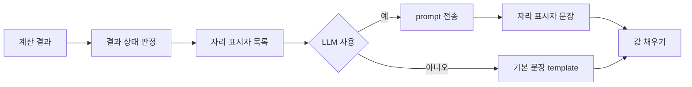

# AI 인사이트 prompt 규칙과 기본 문장 template

- 관련 Issue: #4
- 관련 요구사항: AI-01, AI-02, AI-05, AI-06, DA-11
- 버전: prompt `prompt-2026.10.21-v0.4`, template `tpl-2026.10.19-r2`

계산 엔진(DA-11)이 만든 결과를 셀러가 빠르게 이해하도록 2~3문장으로 설명하는 규칙입니다. LLM은 숫자를 직접 쓰지 않고 자리 표시자만 쓰며, 실제 값은 서버가 채웁니다. LLM이 실패하거나 쓰지 않는 경우에는 같은 자리 표시자를 쓰는 기본 문장을 보여 줍니다.

## 1. 결과 상태

> 아래 판정 조건은 **제안**입니다. 계산 엔진 반환 구조의 `status`는 `NORMAL`, `NO_RESTOCK_NEEDED`, `CANNOT_COMPUTE` 세 가지이므로, 네 가지 상태는 다른 필드와 조합해 판정합니다. 계산 엔진 담당과 확정해야 합니다.

| 상태 | 판정 조건 | LLM 호출 | 설명하는 내용 |
|---|---|---|---|
| 정상 | `NORMAL`이고 아래 조건에 해당하지 않음 | 예 | 권장량, 시나리오 비교, 품절 위험 |
| 확인 필요 | `NORMAL`이고 다음 중 하나: 도착 예정일 없는 발주 물량 있음(`unreflected_pending_qty > 0`), 전체 상품 표본으로 위험 추정(`pooled`), 산식 대체 사유 있음(`method_reason`) | 예 | 정상 내용 + 셀러가 확인할 사항 |
| 판단 보류 | `NORMAL`이지만 표본 부족으로 품절 위험 미산출(`computed = false`) | 예 | 권장량과 잔여 재고만, 위험은 "표본 부족으로 산출하지 않았습니다" |
| 산출 불가 | `CANNOT_COMPUTE` | 아니오 | 계산하지 못한 사유와 입력 조건 |

- 여러 조건에 해당하면 `산출 불가 > 판단 보류 > 확인 필요 > 정상` 순서로 하나만 고릅니다.
- `NO_RESTOCK_NEEDED`(권장량 0개, 입고 불필요)는 네 가지 상태 어디에 넣을지 정해야 합니다. 현재는 정상의 한 경우로 보고, 직접 입력 시나리오가 없으면 LLM을 부르지 않습니다.

## 2. LLM 입력 항목

해당 상품 한 건의 계산 결과만 보냅니다. 입력 구조가 정의되지 않은 필드를 거부하므로(`extra = "forbid"`) 아래 "보내지 않음" 항목은 구조상 들어올 수 없습니다.

| 구분 | 항목 |
|---|---|
| 보냄 | 계산 상태, 적용 산식과 대체 사유 유무, 기존 발주 물량 유무, 위험 산출 여부와 기준, 설명할 시나리오 목록, 자리 표시자 목록 |
| 설정으로 선택 | 자리 표시자 실제 값 (`AI_INSIGHT_INCLUDE_VALUES`: 1 = 값 포함, 0 = 키와 방향만) |
| 보내지 않음 | 수불부 원본, 원가(사입비), 계정 정보, 다른 상품, 상품 목록, 상품명 |

| 상태 | 추가로 보내는 것 | 빼는 것 |
|---|---|---|
| 정상 | 시나리오별 입고량·소진일·잔여 재고·위험, 권장량 대비 방향 | 중복 시나리오 |
| 확인 필요 | 정상 항목 + 산식 대체 사유, 미반영 발주 물량, 위험 기준(전체 상품) | 중복 시나리오 |
| 판단 보류 | 정상 항목에서 위험 값만 제외하고 "산출되지 않음" 표시 | 위험 자리 표시자, 위험 방향 |
| 산출 불가 | 보내지 않음 (LLM 미호출) | 전부 |

## 3. prompt 규칙

| 구분 | 규칙 |
|---|---|
| 역할 | 계산 엔진이 이미 만든 결과를 셀러에게 설명하는 보조자. 수량을 추천하거나 단정하지 않고, 결정은 셀러가 함 |
| 문장 구성 | ① 권장량과 핵심 결과(두괄식, 위험은 추정치임을 함께) ② 감량·증량 시나리오와의 차이 ③ 도착 전 위험은 모든 시나리오 공통 |
| 문장 수 | 2~3문장, 존댓말 평문 |
| 숫자 | 모든 숫자는 `{{키}}`로만 씀. 수량 뒤 `개`, 일수 뒤 `일`. 위험 값은 `%`가 들어 있으므로 붙이지 않음 |
| 방향 | 비교 결과의 방향은 방향 자리 표시자로만 씀. 문장 중간은 `.connect`, 문장 끝은 `.end` |
| 출력 형식 | JSON 하나: `{"sentences": ["문장1", "문장2"]}`. 줄바꿈·마크다운·따옴표 없음 |

## 4. 금지 규칙

어기면 문장 전체를 버리고 기본 문장을 씁니다. 검사 코드는 별도 Issue에서 구현합니다.

| 금지 | 예 | 검사 사유 코드 |
|---|---|---|
| 자리 표시자 밖의 숫자 | `290개`, `8%`, `80% 시나리오` | `raw_number` |
| 한글 수사 | 두 배, 절반, 열흘, 일주일 | `raw_number` |
| 목록에 없는 자리 표시자 | 중복 제외된 시나리오, 위험 미산출 키, 직접 만든 `{{dir.*.s100…}}` | `unknown_key` |
| 필수 자리 표시자 누락 | 정상 상태에서 `{{qty.s100}}` 없음 | `missing_key` |
| 방향을 직접 씀 | 높아집니다, 줄어듭니다, 증가, 더 많은 | `banned_word` |
| 평가·추천·확정 | 최적, 적절, 안전한, 추천, 반드시, 품절됩니다 | `banned_word` |
| 계산 방식·권장량 변경 제안 | 배수를 낮추세요, 300개로 권장 | `banned_word` |
| 위험을 추정치라고 밝히지 않음 | 위험만 쓰고 `{{risk_basis}}`나 "추정" 없음 | `banned_word` |
| 형식 위반 | JSON 아님, 마크다운, 문장 수 범위 밖 | `format` |

## 5. 자리 표시자 목록

- 형식은 `{{키}}`, 시나리오 키 `K`는 `s80`, `s100`(권장량), `s120`, `custom`(직접 입력)입니다.
- 숫자는 천 단위 쉼표, 단위 없이 채웁니다. 비율은 `8%`, 날짜는 `11월 3일` 형식입니다.
- 값이 없는 항목은 목록에 넣지 않습니다. 목록에 없는 키를 쓰면 `unknown_key`입니다.
- "값 예"는 정상 샘플(`K = s80` 기준)과 산출 불가·확인 필요 샘플에서 만든 실제 값입니다.

| 키 | 의미 | 값 예 | 나오는 조건 |
|---|---|---|---|
| `base_date` | 기준일(수불이 확정된 마지막 날) | 6월 15일 | 항상 |
| `lead_time` | 리드타임(일) | 5 | 항상 |
| `restock_cycle` | 입고 주기(일) | 29 | 항상 |
| `cover_days` | 커버 기간(일) = 입고 주기 + 리드타임 | 34 | 항상 |
| `order_unit` | 입고 단위(개) | 10 | 항상 |
| `current_stock` | 기준일 재고(개) | 120 | 항상 |
| `pending_qty` | 커버 기간 안에 도착하는 기존 발주 물량(개) | 50 | 항상 |
| `unreflected_qty` | 도착 예정일이 없어 계산에서 뺀 발주 물량(개) | 30 | 0보다 클 때 |
| `cannot_reason` | 계산 불가 사유(마침표 없음) | 최근 28일 유효 관측일이 … | 산출 불가 |
| `formula` | 적용 산식 이름 | 계산식 A | 산출 불가 아님 |
| `formula_desc` | 적용 산식 설명 | 최근 28일 유효일 평균 판매량을 쓰는 방식 | 산출 불가 아님 |
| `formula_reason` | 이 산식을 쓴 이유 | 작년 동일 구간 … A 사용 불가 | 사유가 있을 때 |
| `cover_demand` | 커버 기간 예상 출고량(개, 배수 적용 전) | 410 | 산출 불가 아님 |
| `multiplier` | 여유 배수 | 110% | 산출 불가 아님 |
| `recent_28d_avg` | 최근 28일 유효일 하루 평균 출고(개) | 12.1 | 값이 있을 때 |
| `risk_before` | 새 물량 도착 전 품절 위험(공통, 추정치) | 5% | 위험 산출 시 |
| `risk_basis` | 위험 기준 | 이 상품의 과거 오차 기준 / 전체 상품의 과거 오차 기준 | 위험 산출 시 |
| `sample_n` | 위험 추정에 쓴 표본 수(건) | 42 | 위험 산출 시 |
| `label.K` | 시나리오 명칭 | 권장량의 80% | 설명 대상 시나리오 |
| `qty.K` | 시나리오 입고량(개) | 240 | 설명 대상 시나리오 |
| `deplete.K` | 재고 소진 예상일 | 7월 12일 / 커버 기간 안에 소진되지 않음 | 설명 대상 시나리오 |
| `remain.K` | 다음 입고 시점 잔여 재고(개) | 0 | 설명 대상 시나리오 |
| `unmet.K` | 커버 기간 중 미충족 수요(개) | 31 | 설명 대상 시나리오 |
| `risk_after.K` | 새 물량 도착 후 품절 위험(추정치) | 25% | 그 시나리오 위험 산출 시 |
| `action.K` | 권장량 대비 셀러의 행동 | 줄이면 / 늘리면 / 그대로 두면 | `K ≠ s100`, 권장량 시나리오 있음 |
| `diff.K` | 권장량과의 입고량 차이(개) | 50 | 위와 같음 |
| `dir.remain.K_s100.connect` | 잔여 재고 방향, 문장 중간용 | 줄지만 / 늘지만 / 같고 | 위와 같음 |
| `dir.remain.K_s100.end` | 잔여 재고 방향, 문장 끝용 | 줄어듭니다 / 늘어납니다 / 같습니다 | 위와 같음 |
| `dir.risk_after.K_s100.connect` | 도착 후 위험 방향, 문장 중간용 | 높아지고 / 낮아지고 / 같고 | 위와 같음 + 두 위험 모두 산출 |
| `dir.risk_after.K_s100.end` | 도착 후 위험 방향, 문장 끝용 | 높아집니다 / 낮아집니다 / 같습니다 | 위와 같음 + 두 위험 모두 산출 |

- 중복 시나리오(올림 후 수량이 같은 시나리오, `duplicate_of`)는 설명 대상이 아니므로 키를 만들지 않습니다.
- 방향 값은 계산 엔진이 준 `vs_recommended`를 우선 쓰고, 없으면 서버가 값을 비교해 정합니다.

## 6. 상태별 기본 문장 template

기본 문장은 아래 조각을 상태에 따라 이어 붙인 뒤 자리 표시자를 채웁니다. 조각에 필요한 키가 없으면 문장 없이 비교표만 보여 줍니다(`template_error`).

| 조각 | template | 쓰는 상태 |
|---|---|---|
| 산출 불가 | 이 상품은 권장 입고량을 계산하지 못했습니다. 사유: `{{cannot_reason}}`. 현재 재고는 `{{current_stock}}`개이며, 리드타임 `{{lead_time}}`일·입고 주기 `{{restock_cycle}}`일 기준입니다. | 산출 불가 |
| 근거 | `{{formula}}`(`{{formula_desc}}`)로 커버 기간 `{{cover_days}}`일 동안 `{{cover_demand}}`개가 팔릴 것으로 예측하고 여유 배수 `{{multiplier}}`를 적용한 뒤, 현재 재고 `{{current_stock}}`개와 도착 예정 물량 `{{pending_qty}}`개를 뺀 권장 입고량은 `{{qty.s100}}`개입니다. | 정상·확인 필요·판단 보류 |
| 산식 사유 | 이 산식을 쓴 이유: `{{formula_reason}}`. | 확인 필요 |
| 미반영 물량 | 도착 예정일이 없는 기존 발주 물량 `{{unreflected_qty}}`개는 계산에 넣지 않았습니다. | 확인 필요 |
| 권장량 (위험 있음) | `{{qty.s100}}`개를 넣으면 다음 입고 때 `{{remain.s100}}`개가 남고 도착 후 품절 위험은 `{{risk_basis}}` 추정치로 `{{risk_after.s100}}`입니다(표본 `{{sample_n}}`건). | 정상·확인 필요 |
| 권장량 (위험 없음) | `{{qty.s100}}`개를 넣으면 다음 입고 때 `{{remain.s100}}`개가 남습니다. 품절 위험은 표본 부족으로 산출하지 않았습니다. | 판단 보류 |
| 다른 시나리오 (위험 있음) | `{{qty.K}}`개로 `{{action.K}}` 다음 입고 때 남는 재고는 `{{remain.K}}`개로 `{{dir.remain.K_s100.connect}}` 품절 위험은 `{{risk_after.K}}`로 `{{dir.risk_after.K_s100.end}}`. | 정상·확인 필요 |
| 다른 시나리오 (위험 없음) | `{{qty.K}}`개로 `{{action.K}}` 다음 입고 때 남는 재고는 `{{remain.K}}`개로 `{{dir.remain.K_s100.end}}`. 이 수량의 품절 위험은 표본 부족으로 산출하지 않았습니다. | 판단 보류 |
| 도착 전 위험 | 새 물량이 도착하기 전까지의 품절 위험은 수량과 관계없이 `{{risk_before}}`입니다. | 위험 산출 시 |
| 입고 불필요 | `{{formula}}`로 예측한 커버 기간 `{{cover_days}}`일의 예상 출고량은 `{{cover_demand}}`개이고, 현재 재고 `{{current_stock}}`개와 도착 예정 물량 `{{pending_qty}}`개로 충당되어 이번에는 입고가 필요하지 않습니다. | `NO_RESTOCK_NEEDED` |
| 직접 입력만 | 직접 입력한 `{{qty.custom}}`개를 넣으면 다음 입고 때 `{{remain.custom}}`개가 남고 도착 후 품절 위험은 `{{risk_basis}}` 추정치로 `{{risk_after.custom}}`입니다. | `NO_RESTOCK_NEEDED` + 직접 입력 |

### 상태별 예시 결과

참조 구현으로 샘플 계산 결과를 넣어 실제로 만든 문장입니다. LLM 없이 이 문장만으로 인사이트를 보여 줄 수 있습니다.

정상 — 중복 시나리오가 있는 건 (80% = 권장량)

계산식 A(작년 같은 시기 판매량에 올해 최근 흐름을 반영하는 방식)로 커버 기간 34일 동안 40개가 팔릴 것으로 예측하고 여유 배수 105%를 적용한 뒤, 현재 재고 10개와 도착 예정 물량 0개를 뺀 권장 입고량은 50개입니다. 50개를 넣으면 다음 입고 때 20개가 남고 도착 후 품절 위험은 이 상품의 과거 오차 기준 추정치로 6%입니다(표본 40건). 100개로 늘리면 다음 입고 때 남는 재고는 70개로 늘지만 품절 위험은 1%로 낮아집니다. 새 물량이 도착하기 전까지의 품절 위험은 수량과 관계없이 12%입니다.

확인 필요 — 전체 상품 표본, 산식 대체 사유

계산식 B(최근 28일 유효일 평균 판매량을 쓰는 방식)로 커버 기간 34일 동안 96개가 팔릴 것으로 예측하고 여유 배수 110%를 적용한 뒤, 현재 재고 30개와 도착 예정 물량 0개를 뺀 권장 입고량은 84개입니다. 이 산식을 쓴 이유: 작년 동일 구간 유효 관측일 부족으로 A 사용 불가. 84개를 넣으면 다음 입고 때 18개가 남고 도착 후 품절 위험은 전체 상품의 과거 오차 기준 추정치로 10%입니다(표본 120건). 72개로 줄이면 다음 입고 때 남는 재고는 0개로 줄지만 품절 위험은 30%로 높아집니다. 108개로 늘리면 다음 입고 때 남는 재고는 42개로 늘지만 품절 위험은 3%로 낮아집니다. 새 물량이 도착하기 전까지의 품절 위험은 수량과 관계없이 7%입니다.

판단 보류 — 표본 부족으로 위험 미산출

계산식 B(최근 28일 유효일 평균 판매량을 쓰는 방식)로 커버 기간 34일 동안 96개가 팔릴 것으로 예측하고 여유 배수 110%를 적용한 뒤, 현재 재고 30개와 도착 예정 물량 0개를 뺀 권장 입고량은 84개입니다. 이 산식을 쓴 이유: 작년 동일 구간 유효 관측일 부족으로 A 사용 불가. 84개를 넣으면 다음 입고 때 18개가 남습니다. 품절 위험은 표본 부족으로 산출하지 않았습니다. 72개로 줄이면 다음 입고 때 남는 재고는 0개로 줄어듭니다. 이 수량의 품절 위험은 표본 부족으로 산출하지 않았습니다. 108개로 늘리면 다음 입고 때 남는 재고는 42개로 늘어납니다. 이 수량의 품절 위험은 표본 부족으로 산출하지 않았습니다.

산출 불가

이 상품은 권장 입고량을 계산하지 못했습니다. 사유: 최근 28일 유효 관측일이 최소 기준에 미달하고 작년 동일 구간 자료가 없습니다. 현재 재고는 0개이며, 리드타임 5일·입고 주기 29일 기준입니다.

입고 불필요 + 직접 입력

계산식 B로 예측한 커버 기간 34일의 예상 출고량은 210개이고, 현재 재고 500개와 도착 예정 물량 100개로 충당되어 이번에는 입고가 필요하지 않습니다. 직접 입력한 100개를 넣으면 다음 입고 때 390개가 남고 도착 후 품절 위험은 이 상품의 과거 오차 기준 추정치로 0%입니다.

## 7. 확인이 필요한 사항

| 항목 | 내용 | 확인할 사람 |
|---|---|---|
| 상태 판정 조건 | 1장의 확인 필요·판단 보류 조건과 `NO_RESTOCK_NEEDED` 위치 | 계산 엔진 담당 |
| 자리 표시자 목록 | 5장 키 이름·값 형식이 계산 결과 필드와 맞는지 | 계산 엔진·백엔드 담당 |
| 입고 불필요 prompt | 입고 불필요 + 직접 입력 건에서 참조 구현 prompt가 목록에 없는 `{{action.custom}}`, `{{dir.remain.custom_s100.end}}`를 안내함. 그대로 쓰면 `unknown_key`로 항상 기본 문장이 나오므로 구현 Issue에서 수정 | AI 담당 |
| 문장 수 | prompt는 2~3문장, 참조 구현 검사 기준은 2~5문장. 예비 평가 후 하나로 확정 | AI 담당 |
| 상태별 prompt | 지금은 모든 상태에 같은 system prompt를 씀. 판단 보류 건에는 위험이 없는 예시 문장을 따로 둘지 검토 | AI 담당 |
