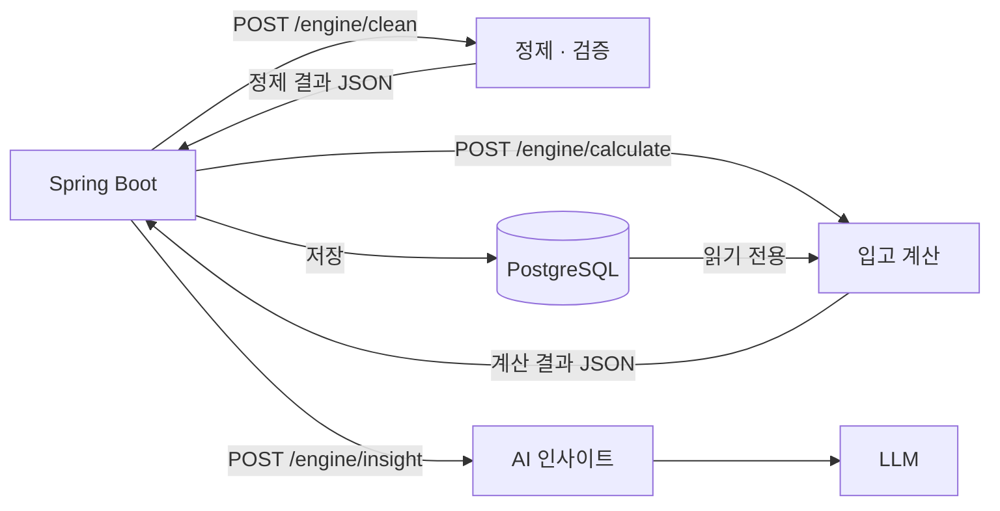

# 구조와 연동

## 호출 흐름

- 엑셀은 정제할 때 한 번만 읽습니다. 계산은 DB의 `product_daily_stocks`를 읽습니다.
- 어느 업로드의 기록을 읽을지는 Spring이 `uploadFileIds`로 알려 줍니다. 덮어쓴 파일은 Spring이 빼고 보냅니다.
- 계약 원본은 `schemas/`입니다. FastAPI가 만드는 OpenAPI(`/docs`, `/openapi.json`)로 Spring DTO를 만듭니다.

## 엔드포인트

| 경로 | 요구사항 | 담당 | 시간 제한 |
|---|---|---|---|
| `POST /engine/clean` | DA-01 · DA-02 | 장준영 | 120초 |
| `POST /engine/calculate` | DA-03 ~ DA-07 · DA-11 · DA-13 | 장준영 | 60초 |
| `POST /engine/scenarios` | DA-06 | 장준영 | 10초 |
| `POST /engine/backtest` | DA-08 ~ DA-10 · DA-12 · DA-13 | 장준영 | 300초 |
| `POST /engine/insight` | AI-01 ~ AI-03 | 이석형 | 15초 |
| `GET /health` | 배포 상태 확인 | 공통 | — |

## mock 모드

`ENGINE_MODE=mock`(기본값)이면 요청 형식만 검사하고 `app/mock_data/`의 명세 예시를 돌려줍니다.
백엔드는 엔진 구현을 기다리지 않고 연동을 시작할 수 있습니다. 엔진 기능을 하나씩 완성하면서 `real`로 바꿉니다.

## 오류 응답

모든 오류는 명세 1장과 같은 `{"code", "message", "details"}` 형식입니다.

| HTTP | code | 언제 |
|---|---|---|
| 422 | `INVALID_INPUT` | 요청이 스키마와 다름 (명세에 없는 필드 포함). `details.errors`에 칸 이름 |
| 404 | `NOT_FOUND` | 없는 경로 |
| 405 | `METHOD_NOT_ALLOWED` | 경로는 있지만 지원하지 않는 요청 방식 |
| 501 | `NOT_IMPLEMENTED` | 아직 구현하지 않은 기능 |
| 501 | `STORAGE_NOT_CONFIGURED` | 원본 파일 저장 위치 미정 |
| 501 | `DATABASE_NOT_CONFIGURED` | DB 연결 미정 |
| 500 | `ENGINE_ERROR` | 예상하지 못한 오류. 내부 내용은 응답에 넣지 않고 서버 로그에만 남김 |

계산 불가(`NOT_CALCULABLE`)와 AI 대체 문장은 오류가 아니라 정상 응답 안의 상태값입니다.

## 엔진 버전

`engine/__init__.py`의 `ENGINE_VERSION`을 Spring이 계산 실행마다 저장해 결과를 재현합니다.

- 정책 · 계산식 · 출력 형식 변경: `0.x.0` 올림
- 버그 수정: `0.0.x` 올림
