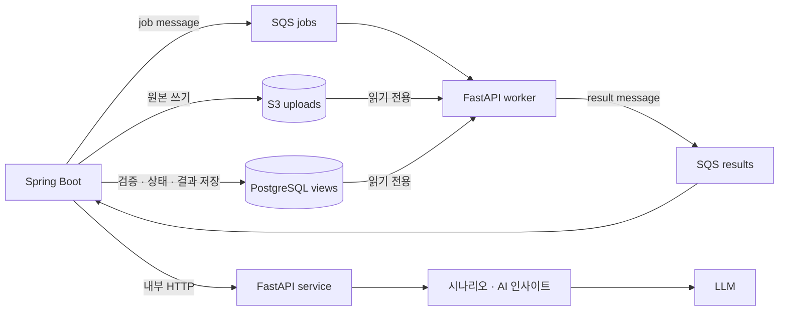

# 구조와 연동

## 호출 흐름

- Spring이 업무 DB와 작업 상태를 소유합니다. FastAPI는 승인된 계산용 view와 필요한 table을
  조회만 하고 결과를 DB에 쓰지 않습니다.
- 엑셀은 정제할 때 S3에서 한 번 읽습니다. 계산은 DB의 일별 재고 view를 읽습니다.
- 정제 작업 1건은 업로드 파일 1개입니다. 어느 업로드의 기록을 읽을지는 Spring이 source ID로
  알려 주며 덮어쓴 파일은 Spring이 제외합니다.
- 월 경계 검산은 Spring이 지정한 이전 유효 source를 기준으로 합니다. FastAPI가 임의로 최신
  업로드를 선택하지 않습니다.
- 계약 원본은 `schemas/`입니다. FastAPI가 만드는 OpenAPI(`/docs`, `/openapi.json`)로 Spring DTO를 만듭니다.

## 데이터와 권한

| 대상 | Spring Boot | FastAPI |
|---|---|---|
| PostgreSQL | 업무 데이터 읽기·쓰기, 결과와 상태 저장 | 승인된 계산용 view와 필요한 table `SELECT` |
| schema migration | 별도 Flyway role로 실행 | 금지 |
| S3 uploads | 읽기·쓰기 | 읽기 |
| SQS jobs | 전송 | 소비 |
| SQS results | 소비 | 전송 |

DB migration role, Spring runtime role, FastAPI reader role의 자격 증명은 분리합니다. queue message에는
원본 파일, DB 자격 증명, 개인정보, 장기 presigned URL을 넣지 않습니다.

## 작업 전달 방식

| 기능 | AWS 전달 방식 | 결과 저장 |
|---|---|---|
| 정제·검증 | SQS worker | Spring이 result message를 검증한 뒤 저장 |
| 입고 계산 | SQS worker | Spring이 result message를 검증한 뒤 저장 |
| 백테스트 | SQS worker | Spring이 result message를 검증한 뒤 저장 |
| 시나리오 | private 내부 HTTP | Spring이 필요한 결과만 저장 |
| AI 인사이트 | private 내부 HTTP | Spring이 필요한 결과만 저장 |

SQS는 at-least-once 전달을 전제로 `jobId` 또는 `runId`를 멱등성 기준으로 사용합니다. message schema와
상태 전이는 Spring #26·#27과 AI worker 구현 PR에서 함께 확정합니다.

## 엔드포인트

| 경로 | 요구사항 | 담당 | 시간 제한 |
|---|---|---|---|
| `POST /engine/clean` | DA-01 · DA-02 | 장준영 | 120초 |
| `POST /engine/calculate` | DA-03 ~ DA-07 · DA-11 · DA-13 | 장준영 | 60초 |
| `POST /engine/scenarios` | DA-06 | 장준영 | 10초 |
| `POST /engine/backtest` | DA-08 ~ DA-10 · DA-12 · DA-13 | 장준영 | 300초 |
| `POST /engine/insight` | AI-01 ~ AI-03 | 이석형 | 15초 |
| `GET /health` | 배포 상태 확인 | 공통 | — |

현재 HTTP endpoint는 mock 연동과 engine 함수의 계약 검증에 사용합니다. AWS 목표 환경에서
`clean`·`calculate`·`backtest`는 외부 HTTP로 공개하지 않고 worker가 같은 application service를
호출합니다. `scenarios`·`insight`만 Spring task에서 접근 가능한 내부 HTTP endpoint로 운영합니다.

## mock 모드

`ENGINE_MODE=mock`(기본값)이면 요청 형식만 검사하고 `app/mock_data/`의 명세 예시를 돌려줍니다.
백엔드는 엔진 구현을 기다리지 않고 연동을 시작할 수 있습니다. 엔진 기능을 하나씩 완성하면서 `real`로 바꿉니다.

## 오류 응답

모든 오류는 명세 1장과 같은 `{"code", "message", "details"}` 형식입니다.

| HTTP | code | 언제 |
|---|---|---|
| 422 | `INVALID_INPUT` | 요청이 스키마와 다름 (명세에 없는 필드 포함). `details.errors`에 칸 이름 |
| 404 | `NOT_FOUND` | 없는 경로 |
| 405 | `METHOD_NOT_ALLOWED` | 경로는 있지만 지원하지 않는 요청 방식 |
| 501 | `NOT_IMPLEMENTED` | 아직 구현하지 않은 기능 |
| 501 | `STORAGE_NOT_CONFIGURED` | 현재 실행 환경의 local/S3 storage adapter가 설정되지 않음 |
| 501 | `DATABASE_NOT_CONFIGURED` | 현재 실행 환경의 읽기 전용 DB 연결이 설정되지 않음 |
| 500 | `ENGINE_ERROR` | 예상하지 못한 오류. 내부 내용은 응답에 넣지 않고 서버 로그에만 남김 |

계산 불가(`NOT_CALCULABLE`)와 AI 대체 문장은 오류가 아니라 정상 응답 안의 상태값입니다.

## 엔진 버전

`engine/__init__.py`의 `ENGINE_VERSION`을 Spring이 계산 실행마다 저장해 결과를 재현합니다.

- 정책 · 계산식 · 출력 형식 변경: `0.x.0` 올림
- 버그 수정: `0.0.x` 올림
