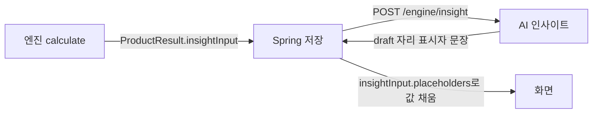

# 0002. AI 인사이트 연동 계약 — 합의 초안

- 상태: **초안** (이석형 님 확인 전) · Issue #7
- 기준: API 명세서 4장 `/engine/insight` · 5장, [0001](0001-engine-contract.md), [prompt 규칙과 기본 문장](../ai-insight/prompt-and-fallback.md) (#4)
- 관련 요구사항: DA-11, AI-01 ~ AI-03, AI-05, AI-06

기존 `ai_insight` 코드는 0001 합의 전에 만든 테스트 코드라서 `schemas/`와 다른 곳이 있습니다. 이석형 님이 정리한 비교표를 바탕으로 **이미 정해진 것**, **합의했지만 기록이 없는 것**, **새로 정할 것**을 나눴습니다. 각 항목에 동의 / 수정 의견을 달아 주세요.

## 1. 이미 정해진 것 — 기존 코드를 맞춤

| 항목 | 기존 `ai_insight` | 맞출 기준 |
|---|---|---|
| 시나리오 키 | `s80` · `s100` · `s120` · `custom` | `P80` · `P100` · `P120` · `CUSTOM` (`schemas/base.py`). 자리 표시자 이름 안에서는 소문자 `p80` |
| 결과 상태 | `NORMAL` · `NO_RESTOCK_NEEDED` · `CANNOT_COMPUTE` | `ResultStatus` 5개 + `RiskStatus` 3개 (명세 6장). 4장 매핑 참고 |
| 엔드포인트 | `/insight` · `/insight/validate` · `/insight/catalog` · `/health` | `/engine/insight` 하나. 검사기 · 목록은 `insight/` 안의 함수와 테스트로 유지. `/health`는 `app/main.py`에 있으므로 삭제 |
| 스키마 위치 | `ai_insight` 안에 자체 모델 | `schemas/insight.py` 하나 (0001 결정 2) |

## 2. 합의했지만 기록이 없는 것 — 확인만

| # | 항목 | 내용 |
|---|---|---|
| 2-1 | 입력을 만드는 쪽 | 엔진이 `engine/insight_facts.py`의 `to_insight_input()`으로 만든다 (DA-11 완료 조건) |
| 2-2 | 자리 표시자 이름 | `qty_p100`처럼 snake_case, 시나리오는 접미사 `_p80` · `_p100` · `_p120` · `_custom` |
| 2-3 | 방향 값 | `directions` 값은 `높음` · `낮음` · `같음` 3가지 |

## 3. 새로 정할 것

### 3-1. 입력이 Spring을 거쳐 돌아오는 경로

지금 `InsightRequest`는 `{resultId, input}`인데 `CalculateResponse`에는 InsightInput이 없습니다. 그대로 두면 Spring이 입력을 직접 만들어야 해서 자리 표시자 로직이 세 곳(엔진 · 인사이트 · Spring)에 생깁니다.

**제안:** 엔진이 계산할 때 `ProductResult.insightInput`을 채우고, Spring은 저장했다가 `/engine/insight`에 그대로 보냅니다.



### 3-2. 기존 `build_catalog` 로직 위치

`engine/`은 `insight/`를 import할 수 없으므로(경계 테스트), 기존 `placeholders.build_catalog` 로직을 **새로 짜지 않고 `engine/insight_facts.py`로 옮깁니다.** 담당은 장준영, 리뷰는 이석형 님입니다. `insight/`는 `schemas`와 `engine.insight_facts`를 import해서 씁니다.

### 3-3. InsightInput 필드

prompt가 정상 · 확인 필요 · 판단 보류를 구분하려면 이름 목록만으로는 부족합니다. `placeholders`는 목록에서 **이름 → 화면 형식 값** dict로 바꿉니다. Spring은 이 dict로 값을 채우고, LLM에 값을 보낼지는 `AI_INSIGHT_INCLUDE_VALUES`로 정합니다.

| 필드 | 형식 | 용도 | 변경 |
|---|---|---|---|
| `skuLabel` | `"상품 A"` | 실제 상품명 대신 | 유지 |
| `status` | `ResultStatus` | 상태 판정 | 추가 |
| `riskStatus` | `RiskStatus` | 판단 보류 판정 | 유지 |
| `recommended` | `ScenarioType` | 권장 시나리오 | 유지 |
| `scenarios` | `["P80", "P100", "P120"]` | 설명할 시나리오 (중복 제외) | 추가 |
| `methodFallback` | bool | 기본 산식 대신 다른 산식을 썼는지 → 확인 필요 | 추가 |
| `hasNoDateReceipts` | bool | 도착 예정일 없는 발주가 있는지 → 확인 필요 | 추가 (5장 확인 필요) |
| `placeholders` | `{"qty_p100": "1,240", ...}` | 자리 표시자 이름과 값 | 목록 → dict |
| `directions` | `{"risk_post_p80_vs_p100": "높음", ...}` | 권장량 대비 방향 | 유지 |

<details>
<summary>입력 예시</summary>

```json
{
  "skuLabel": "상품 A",
  "status": "OK",
  "riskStatus": "OK",
  "recommended": "P100",
  "scenarios": ["P80", "P100", "P120"],
  "methodFallback": true,
  "hasNoDateReceipts": false,
  "placeholders": {
    "method": "계산식 B", "method_reason": "작년 동일 구간 유효 관측일 부족으로 A 사용 불가",
    "horizon_days": "34", "forecast_outbound": "96", "multiplier": "110%",
    "start_stock": "30", "planned_receipts": "0",
    "qty_p80": "72", "qty_p100": "84", "qty_p120": "108",
    "ending_p80": "0", "ending_p100": "18", "ending_p120": "42",
    "risk_post_p80": "30%", "risk_post_p100": "10%", "risk_post_p120": "3%",
    "risk_pre": "7%", "risk_sample_size": "120"
  },
  "directions": {
    "ending_p80_vs_p100": "낮음", "risk_post_p80_vs_p100": "높음",
    "ending_p120_vs_p100": "높음", "risk_post_p120_vs_p100": "낮음"
  }
}
```
</details>

### 3-4. 자리 표시자 이름 대응표

원칙: **`schemas/engine.py` 필드 이름을 따릅니다.** 0001 미정의 `ending_p120` · `risk_post_p120`은 아래 규칙으로 함께 정해집니다.

| 기존 (#4 문서) | 새 이름 | 비고 |
|---|---|---|
| `base_date` | `as_of_date` | `CalculateRequest.as_of_date` |
| `lead_time` · `restock_cycle` · `order_unit` | `lead_time_days` · `review_cycle_days` · `order_unit_qty` | `ProductSettings` |
| `cover_days` | `horizon_days` | |
| `current_stock` | `start_stock` | |
| `pending_qty` | `planned_receipts` | 커버 기간 안 도착분 |
| `unreflected_qty` | `no_date_receipts` | 5장 확인 필요 |
| `cannot_reason` | `reason` | |
| `formula` · `formula_reason` | `method` · `method_reason` | |
| `formula_desc` | 없음 | 산식별 고정 문구 → `insight/` 상수 |
| `cover_demand` | `forecast_outbound` | 배수 적용 전 |
| `multiplier` | `multiplier` | |
| `recent_28d_avg` | 없음 | `ProductResult`에 없음. 필요하면 요청 |
| `risk_before` | `risk_pre` | |
| `risk_basis` | 미정 | 5장 pooled 결정에 따름 |
| `sample_n` | `risk_sample_size` | |
| `qty.K` · `remain.K` · `deplete.K` · `unmet.K` | `qty_pK` · `ending_pK` · `depletion_pK` · `unmet_pK` | `ScenarioResult` |
| `risk_after.K` | `risk_post_pK` | |
| `diff.K` | `diff_pK` | 권장량과의 수량 차이 |
| `label.K` · `action.K` | 없음 | 숫자가 아닌 고정 문구 → 3-6 |
| `dir.*.connect` · `dir.*.end` | `dir_ending_pK_connect` 등 | 3-6 |

### 3-5. 자리 표시자 문법은 `{{이름}}`

LLM 출력이 `{"sentences": [...]}` JSON이라 중괄호 1개는 헷갈립니다. 이름은 2-2 규칙, 감싸는 문법은 기존 `{{ }}`를 씁니다. 예: `권장량 {{qty_p100}}개를 넣으면`. mock 응답(`app/mock_data/insight.json`)도 같이 고칩니다.

### 3-6. 숫자가 아닌 자리 표시자는 FastAPI가 채움

방향(`높아지고` · `높아집니다`), 행동(`줄이면` · `늘리면`), 시나리오 명칭은 입력의 `directions`와 시나리오 정보만으로 정해집니다. **FastAPI가 응답 전에 이 문구를 채우고, Spring에는 숫자 자리 표시자만 남은 `draft`를 보냅니다.** Spring은 한국어 활용형 규칙을 몰라도 되고, `VALUE_MISMATCH` 검사는 숫자만 보면 됩니다.

### 3-7. 응답에 기본 문장 · 설명 방식 · 버전 추가

LLM이 실패하면 FastAPI가 기본 문장(template)을 같은 자리 표시자 형태로 `draft`에 담습니다. Spring은 어느 경우든 값만 채우면 되고, template을 Java로 다시 만들지 않습니다.

| 필드 | 값 | 변경 |
|---|---|---|
| `validation` | `PASSED` · `FAILED` (LLM 문장 검사 결과) | 유지 |
| `mode` | `LLM` (LLM 문장 통과) · `TEMPLATE` (LLM 미호출 · 실패 → 기본 문장) · `NONE` (기본 문장도 실패 → 비교표만) | 추가 |
| `draft` | 자리 표시자 문장. `NONE`이면 null | 의미 변경 |
| `failReason` | `LLM_ERROR` · `LLM_TIMEOUT` · `VALIDATION_FAILED` | 유지 |
| `failDetail` | `raw_number` · `unknown_key` 등 상세 사유 | 추가 (로그용) |
| `promptVersion` · `templateVersion` | `prompt-2026.10.21-v0.4` 등 | 추가 |
| `latencyMs` · `costUsd` | | 유지 |

명세가 바뀌는 항목이라 합의 후 명세 → `schemas/` → Spring 순서로 반영합니다.

## 4. 상태 매핑 (#4 문서 1장 갱신용)

여러 조건이 겹치면 `산출 불가 > 판단 보류 > 확인 필요 > 정상` 순서로 하나만 고르는 규칙은 그대로입니다. 판정은 `insight/`가 InsightInput만 보고 합니다.

| 입력 | 인사이트 상태 | LLM | `mode` |
|---|---|---|---|
| `status=OK`, `riskStatus=OK`, 아래 조건 없음 | 정상 | 예 | `LLM` 또는 `TEMPLATE` |
| `status=OK` + `methodFallback` 또는 `hasNoDateReceipts` | 확인 필요 | 예 | `LLM` 또는 `TEMPLATE` |
| `status=OK` + `riskStatus`가 `INSUFFICIENT_SAMPLE` · `LOW_GRADE` | 판단 보류 | 예 | `LLM` 또는 `TEMPLATE` |
| `status=NOT_NEEDED` | 입고 불필요 | 아니오 | `TEMPLATE` |
| `status=NOT_CALCULABLE` | 산출 불가 | 아니오 | `TEMPLATE` |
| `status=EXCLUDED` · `REUPLOAD_REQUIRED` | 산출 불가 | 아니오 | `TEMPLATE` (5장 확인 필요) |

## 5. 아직 열린 것

| 항목 | 내용 | 확인할 사람 |
|---|---|---|
| pooled 위험 | 표본이 부족할 때 전체 상품 표본으로 위험을 추정할지, `INSUFFICIENT_SAMPLE`로 끝낼지. 안 하면 `risk_basis` 삭제 | 장준영 |
| 도착 예정일 없는 발주 | 지금은 Spring이 빼고 보내서 엔진이 모름. `CalculateRequest`에 수량을 함께 받을지 | 장준영 · 백엔드 |
| 화면 값 형식 | 소수인 재고(`ending` · `start_stock`)를 `placeholders`에 어떻게 넣을지. 0001 미정 "화면 정수 표시 규칙"에 따름 | 프론트 · 백엔드 |
| 직접 입력 시나리오 | `/engine/scenarios`로 `CUSTOM`이 생기면 인사이트를 다시 만들지, 입력은 누가 갱신할지 | 이석형 · 백엔드 |
| `EXCLUDED` · `REUPLOAD_REQUIRED` | 인사이트 문장을 보여 줄지, Spring이 호출하지 않을지 | 백엔드 |
| `insightInput` 저장 · 응답 필드 추가 · `{{ }}` 문법 | 3-1, 3-5, 3-7 | 백엔드 |

## 합의 후 할 일

- [ ] 이 문서 상태를 "결정"으로 바꾸고 날짜 기록, 0001 미정의 자리 표시자 항목 닫기
- [ ] `schemas/insight.py` · `schemas/engine.py`(`insightInput`) 수정 — 장준영
- [ ] `engine/insight_facts.py`로 `build_catalog` 이식, 이석형 님 리뷰 — 장준영
- [ ] `insight/`로 기존 코드 이동, 이름 · 상태값 교체, 검사기 정규식 갱신 — 이석형
- [ ] #4 문서(prompt · template) 자리 표시자 이름과 상태 매핑 갱신 — 이석형
- [ ] 백엔드에 3-1 · 3-5 · 3-7 공유, 명세 반영 요청
